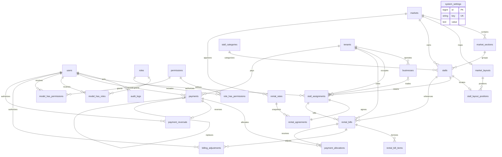

# Database ER diagram

Amounts use DECIMAL(14,2), area DECIMAL(10,2), MySQL InnoDB/utf8mb4, restricted historical foreign keys. No physical deletion workflow is exposed. Financial detail and audit models reject updates/deletes; trusted database administrators remain outside application authorization.

Unique constraints: market code; market+section code; market+stall code; tenant reference; agreement reference; assignment+period bill; payment submission key/reference; active receipt reference; replacement_of_id; one reversal per payment; payment+bill allocation; adjustment submission key; stall position; nullable active_stall_id.

Core migrations: Laravel users/password resets/failed jobs plus permission tables and market schema. Sanctum API is not enabled. Amounts are calculated with BCMath string arithmetic. Nullable active-slot fields allow retained history while enforcing one effective reservation.
