# City Government of San Pedro, Laguna

# Market Stall Management and Monitoring System

# Complete User Manual

**Operational reference v1.6 — prepared for LGU review**

**Preparation date:** 26 November 2026

**Application:** MarketHub, Laravel 8.83.29, working source snapshot of 26 November 2026

**Source revision:** recorded in the export build manifest.

This document describes the implemented application. It is a training and operational reference prepared for review; it does not represent an approved official LGU manual, a legal opinion, a policy approval, or production acceptance. Only duly authorized personnel can approve rates, templates, contract issuance, and financial corrections. No signature, official seal, or approval is invented here.

Screenshots show the actual application using synthetic records in an isolated demonstration database. They illustrate the screen identified in each caption. Repeated screenshots in Chapter 12 identify the relevant screen, rather than claiming that every policy-gated action was performed. Source-verified instructions, automated checks, browser demonstrations, and outstanding acceptance work are distinguished in the accompanying Coverage Matrix.

| Revision | Date | Description | Approval status |
| --- | --- | --- | --- |
| 1.5 | 2026-11-26 | Optional assignment information and automatic agreement references | LGU review pending |
| 1.4 | 2026-11-26 | Optional fixed-day assignments and separate billing periods | LGU review pending |
| 1.3 | 2026-11-20 | Keyboard navigation, form recovery, scrollable tables and contract confirmations | LGU review pending |
| 1.2 | 2026-11-19 | Market Sections and assignment-specific rental overrides | LGU review pending |
| 1.1 | 2026-11-18 | Unified tenant registration, business categories, rental assessments and three reports | LGU review pending |
| 1.0 | 2026-11-18 | Initial operational reference, fictional lifecycle, screenshots and workflow diagrams | LGU review pending |

## Contents

1. [Introduction](#chapter-1-introduction)
2. [Getting Started](#chapter-2-getting-started)
3. [User Roles and Access Permissions](#chapter-3-user-roles-and-access-permissions)
4. [Initial System Configuration](#chapter-4-initial-system-configuration)
5. [Stall Management](#chapter-5-stall-management)
6. [Tenant Management](#chapter-6-tenant-management)
7. [Lease and Contract Management](#chapter-7-lease-and-contract-management)
8. [Rental and Payment Monitoring](#chapter-8-rental-and-payment-monitoring)
9. [Dashboard and Monitoring](#chapter-9-dashboard-and-monitoring)
10. [Reports and Printing](#chapter-10-reports-and-printing)
11. [User Account and Administration](#chapter-11-user-account-and-administration)
12. [Complete 360° Operational Workflow](#chapter-12-complete-360-operational-workflow)
13. [Troubleshooting and Frequently Asked Questions](#chapter-13-troubleshooting-and-frequently-asked-questions)
14. [Data Privacy and Security](#chapter-14-data-privacy-and-security)

## Chapter 1 — Introduction

### 1.1 Purpose and intended users

MarketHub connects market and stall records, tenant profiles, occupancy assignments, rental agreements, bills, recorded payment references, monitoring and reports. Its purpose is to give authorized market personnel a consistent record of who occupies a stall and the financial activity attached to that occupancy. It retains earlier assignments and posted financial records.

Administrators configure locations, rates, accounts and approved access. Market personnel maintain stalls and tenants within their permissions. Collection officers record and post authorized payment information. Treasury/Accounting personnel review corrections and reconciliation. Management viewers monitor occupancy and permitted aggregate reports. These are the six existing application roles; job titles outside the application do not automatically grant access.

### 1.2 Capabilities and boundaries

Implemented workflows cover authentication, the dashboard, markets and inventory, the stall map, tenant and business registration, assignments and renewals, rent approvals and frozen assessments, supported monthly lease contracts, billing and payment drafts and posting, financial corrections, Treasury reconciliation, receivables, twenty reports, accounts, settings and the audit log. MIS can enable fixed-day terms for new assignments following the rollout procedure.

The current application has no self-service account profile, change-password screen, password-recovery screen, official receipt issuance, workbook import interface, separate building/zone registry, drag-and-drop map editor, arbitrary permission editor, automatic lease renewal, or dashboard widget for expiring contracts. Floor/building is a stall text field. Sections represent the configured subdivisions. Existing tenant records can be archived or deactivated; the application does not expose ordinary record deletion routes.

Monthly assessments use the approved category rate, stall location and area, and the effective market policy. Legacy agreements use their saved monthly amount. With the opt-in feature enabled, new assignments and renewals use fixed-day terms. The assessment freezes a chosen interval, normally seven days, and uses the approved category rate and verified stall measurements. It records optional CUSA separately and bills base rent for each complete interval. Existing controls govern posting and corrections.

### 1.3 Requirements and access

The intended environment is the existing local XAMPP installation serving only the application's `public/` directory. The local access address is normally `http://localhost/market-stall/`; MIS must supply the actual authorized address for another workstation. `localhost` refers to the computer on which the browser is running. Do not publish the project root or attempt to expose unrelated XAMPP applications.

Use a current browser capable of JavaScript, cookies, local storage and downloading PDF/DOCX files. Edge and Chrome are practical choices for local training; the project does not publish a certified browser/version support matrix. The interface has desktop and responsive mobile/tablet navigation. Enable JavaScript for map details, charts, confirmations and the mobile drawer. PDF viewing and printing need a compatible viewer; editable contract preview needs Microsoft Word or another authorized compatible DOCX application. Contract PDF conversion depends on a separately configured compatible local converter and may be unavailable.

The source targets PHP 7.4 syntax, Laravel 8.83.29, MySQL and locally compiled Tailwind CSS 3. The available development runtime and disposable tests do not establish actual PHP 7.4 runtime compatibility or MySQL concurrency acceptance. This unsupported stack is not approved for internet-facing production.

### 1.4 Terms used in the manual

| Term | Operational meaning |
| --- | --- |
| Tenant / stallholder | Person recorded as the tenant; a business is a separate linked record. |
| Stall | Physical inventory record within a market and section. |
| Assignment | Dated relationship between a tenant and a stall, with occupancy history. |
| Rental agreement | Financial terms created with an assignment, linked to an assessment or to a legacy monthly rate. |
| Rental assessment | Frozen record of the approved rate, stall measurements, billing terms and calculated amounts for a reference period. Includes the applicable market policy when required. |
| Lease contract | Separately controlled document record with private generated files and approval stages. |
| Draft | Saved for review; it has not yet become posted financial activity. |
| Posted | Committed through the authorized financial workflow; corrections append history. |
| Allocation | Portion of a recorded payment applied to one posted bill. |
| Reversal | Preserved correction that removes a posted payment's effect from balances. |
| Treasury confirmation | Separate reconciliation status; posting initially remains pending. |
| CUSA | The approved monthly treatment is kept on monthly records. Fixed-day assessments can record CUSA for reference only. |
| Approval reference | Reference to an actual authorized policy, decision or review; free text alone does not create authority. |

### 1.5 Read the workflow before entering records

1. Read the role matrix in Chapter 3 and identify the officer responsible for each controlled action.
2. Confirm that the installation and database are the authorized operational or isolated training environment.
3. Follow the configuration sequence in Chapter 4 before attempting assignment or billing.
4. Use the fictional Chapter 12 exercise only in training; use verified records and approved references in operations.

**Expected response:** the responsible officer can identify the location, tenant, assignment, agreement, bill and payment as different linked records. **Validation:** there is no application button that approves this manual or establishes a new LGU policy. **Common mistake:** treating a successful save or a sample number as an official approval.

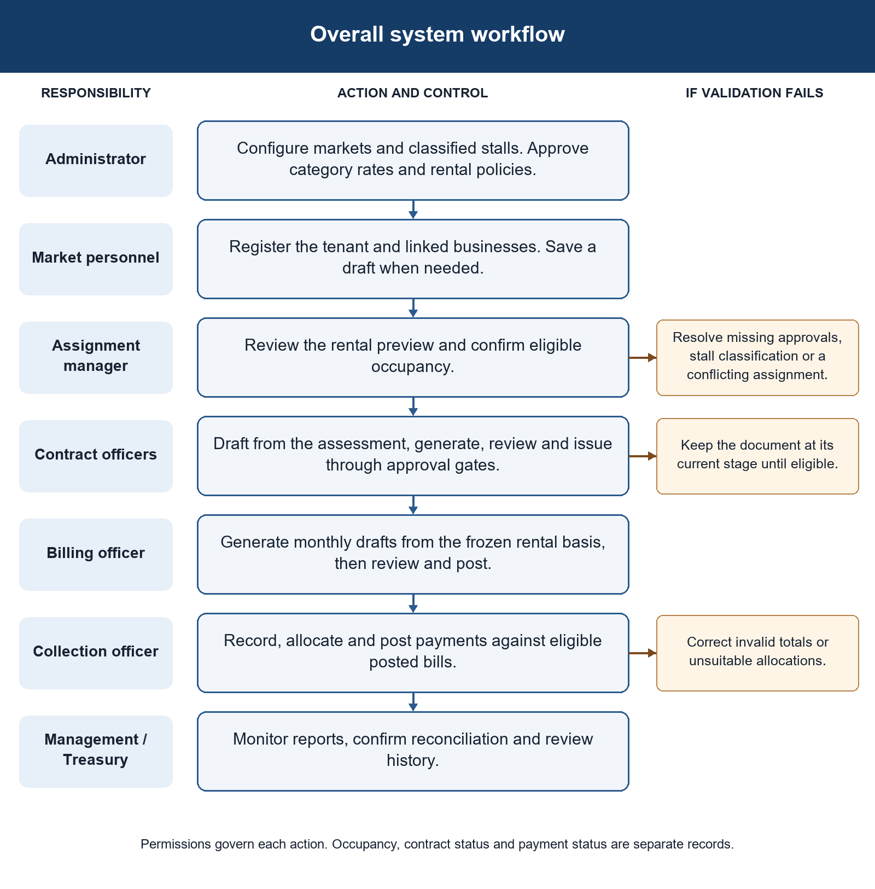

Figure W01. Overall implemented flow and separate document and financial controls.

## Chapter 2 — Getting Started

### 2.1 Access and login

1. Open the authorized application address. The local XAMPP address is `http://localhost/market-stall/`.
2. Enter the email address assigned to your own account. The application uses email login, not a username.
3. Enter your private password and select **Sign in**.
4. Confirm that the dashboard and your account name/role appear. If you intended to open another authorized page, the application may return you to that page.

**Expected response:** a successful login opens the dashboard or intended page and records login activity. **Validation:** the actual failure text is **“The credentials are incorrect or this account is disabled.”** Repeated failures can produce **“Too many attempts. Try again in … seconds.”** Wait for the stated interval before retrying. **Common mistakes:** entering a username, using another officer's account, or repeatedly submitting while locked out. Ask the administrator to confirm email and active status without asking them to disclose a password.

Figure 01. Actual login screen; credentials are deliberately absent.

### 2.2 Dashboard and sidebar

1. Read the page title to confirm which module is open.
2. Expand a sidebar group and select an available item. Empty groups are hidden when your account has no permitted items.
3. Use **Dashboard** to return to the overview. Use market/date filters and **Update overview** when needed.
4. On a narrow screen, select **Menu** to open the drawer. Use Tab to move within it. Select a link to navigate or press Escape or **Close navigation** to close it and return focus to **Menu**. If the drawer controls are unavailable, use the navigation groups and **Sign out** above the page content.
5. On desktop, use the sidebar display control if a narrower icon rail is preferable. Group and display preferences may be remembered in that browser.

On wide tables, use Tab to reach the named table area and the Left and Right arrow keys to scroll across columns. Use Tab again to reach links and controls. On a touch screen, scroll sideways inside the table to view more columns.

**Expected response:** the selected module becomes active. Navigation preferences affect presentation; records remain in the server database. **Validation:** a hidden menu can indicate a missing permission; manually entering a URL does not grant it. **Common mistakes:** assuming a collapsed group is missing, or interpreting a viewer's limited menu as data loss. Ask the administrator to check the assigned role.

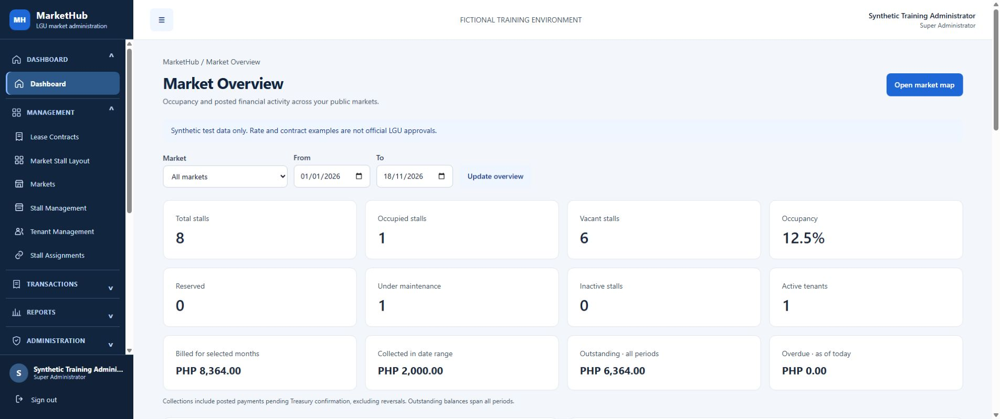

Figure 02. Dashboard, sidebar categories and market/date controls in the demonstration environment.

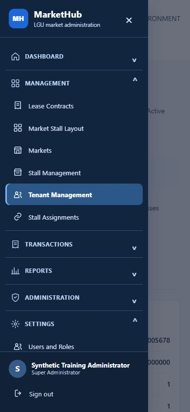

Figure 26. Responsive menu drawer; the available links still depend on the signed-in role.

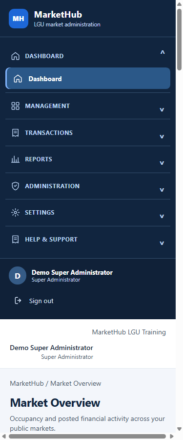

Figure 64. The same navigation groups and Sign out remain available above the page when the drawer script is unavailable.

The groups are **Dashboard**, **Management**, **Transactions**, **Reports**, **Administration**, **Settings**, and **Help & Support**. Use **Tenant Management** under Management for tenant and business records. **Transactions** includes Rental Billing, Rental Payments, Payment History and Outstanding Balances as permitted. **Administration** provides Audit Logs. **Settings** contains Users and Roles, Business Categories, Rental Policies, Contract Templates, Market Sections, Stall Categories, Legacy Rental Rates and System Settings. Help & Support provides User Manual, Quick Reference, System Workflows and FAQs through authenticated routes.

### 2.3 Account details, passwords and logout

There is no ordinary self-service profile or password-change page. The account name/role in the sidebar is identification, not a profile editor. For a name/email change or password reset, contact an officer with **Users and Roles** access. That officer can update the account and supply a new password through the staff form; see Chapter 11. There is no documented first-login forced password change or email recovery workflow.

1. Save or cancel any unfinished form.
2. Select **Sign out** in the sidebar footer.
3. Confirm that the login page appears before leaving a shared workstation.

**Expected response:** logout invalidates the session and returns to login. **Validation:** a session that has already expired may require signing in again. **Common mistake:** closing only a tab while leaving an authenticated session available in another tab.

### 2.4 Find guides and download the manual

1. Expand **Help & Support** and select **User Manual**, **Quick Reference**, **System Workflows** or **FAQs**. The same guides are available from Help home.
2. Enter a phrase in **Search topics**, optionally select a category, then choose **Search help**. Search matches chapter text; it does not search operational tenant records.
3. Open a chapter from the results or the manual contents. Images and workflow diagrams load through authenticated application routes.
4. Use **Download User Manual (PDF)**, **Download User Manual (Word)** or **Download Quick Reference Guide (PDF)** while signed in. **Preview** opens a PDF in a new tab when the browser supports it.
5. Check the version and updated date before using a printed copy. Protect any accompanying operational report or contract separately.

**Expected response:** permitted users can read searchable guides and obtain the available exports. **Validation:** a missing export displays **Not available yet**; an unknown document key returns404 and a guest is redirected to login. **Common mistake:** treating a guide download as approval of a rate, template or legal contract. The editable Word manual is generated from the same text but its pagination needs a compatible Word/LibreOffice review.

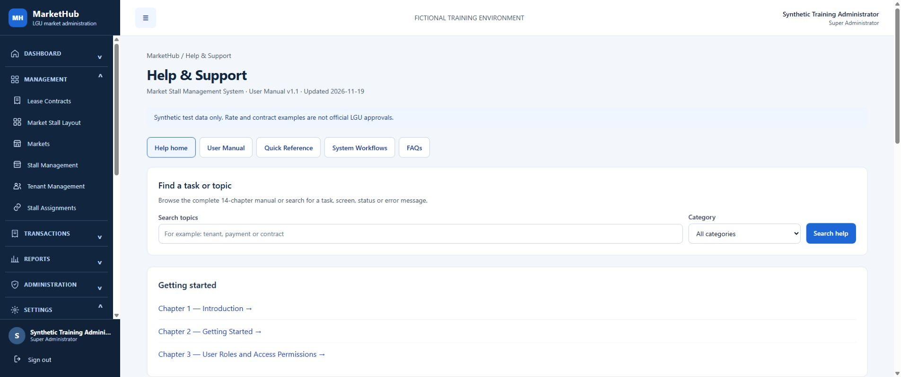

Figure 44. Actual Help Center showing categorized guides, version and protected download/preview controls.

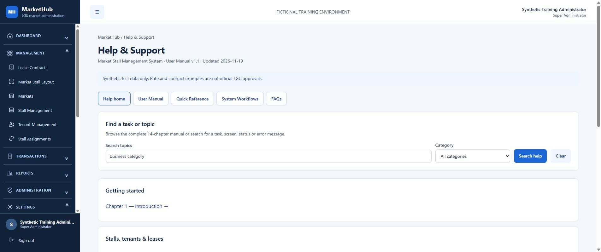

Figure 45. Actual search results for a tenant-related documentation query.

## Chapter 3 — User Roles and Access Permissions

### 3.1 How authorization works

Permissions are explicit. Even Super Administrator has no unconditional bypass of financial or contract rules. A person assigned multiple roles may have the combined permissions; the ordinary staff-management form replaces the account's roles with the single selected role when saved. The table below records the seeded defaults, including the contract permissions and the separate rate and policy approval grant. Actual account permissions must be checked by the administrator after role seeding or authorized customization.

**SA** = Super Administrator; **MA** = Market Administrator; **MS** = Market Staff; **CO** = Authorized Collection Officer; **TA** = Treasury/Accounting Officer; **MV** = LGU Management Viewer. A check means the permission is in that role's seeded grants; a dash means it is absent. Validation, record state and additional checks still apply.

| Permission | SA | MA | MS | CO | TA | MV |
| --- | --- | --- | --- | --- | --- | --- |
| assignments.manage | ✓ | ✓ | — | — | — | — |
| assignments.view | ✓ | ✓ | ✓ | ✓ | ✓ | — |
| audit.view | ✓ | — | — | — | ✓ | — |
| billing.adjust | ✓ | — | — | — | ✓ | — |
| billing.generate | ✓ | ✓ | — | — | — | — |
| billing.post | ✓ | ✓ | — | — | — | — |
| billing.view | ✓ | ✓ | ✓ | ✓ | ✓ | — |
| contract_templates.approve | ✓ | — | — | — | — | — |
| contract_templates.manage | ✓ | — | — | — | — | — |
| contracts.approve | ✓ | — | — | — | — | — |
| contracts.create | ✓ | ✓ | ✓ | — | — | — |
| contracts.download | ✓ | ✓ | — | — | — | — |
| contracts.generate | ✓ | ✓ | — | — | — | — |
| contracts.issue | ✓ | — | — | — | — | — |
| contracts.print | ✓ | ✓ | — | — | — | — |
| contracts.upload_signed | ✓ | ✓ | — | — | — | — |
| contracts.view | ✓ | ✓ | ✓ | — | — | — |
| contracts.void | ✓ | — | — | — | — | — |
| dashboard.view | ✓ | ✓ | ✓ | ✓ | ✓ | ✓ |
| financial.backdate | ✓ | — | — | — | ✓ | — |
| map.view | ✓ | ✓ | ✓ | ✓ | ✓ | ✓ |
| markets.manage | ✓ | ✓ | — | — | — | — |
| markets.view | ✓ | ✓ | ✓ | ✓ | ✓ | ✓ |
| payments.post | ✓ | — | — | ✓ | — | — |
| payments.reconcile | ✓ | — | — | — | ✓ | — |
| payments.record | ✓ | — | — | ✓ | — | — |
| payments.reverse | ✓ | — | — | — | ✓ | — |
| payments.view | ✓ | ✓ | ✓ | ✓ | ✓ | — |
| rates.approve | ✓ | — | — | — | — | — |
| rates.manage | ✓ | ✓ | — | — | — | — |
| rates.view | ✓ | ✓ | ✓ | ✓ | ✓ | — |
| rentals.override.approve | ✓ | — | — | — | — | — |
| rentals.override.history | ✓ | ✓ | ✓ | — | ✓ | — |
| rentals.override.reject | ✓ | — | — | — | — | — |
| rentals.override.report | ✓ | ✓ | — | — | ✓ | — |
| rentals.override.request | ✓ | ✓ | ✓ | — | — | — |
| rentals.override.revoke | ✓ | — | — | — | — | — |
| rentals.override.view | ✓ | ✓ | ✓ | — | ✓ | — |
| reports.financial | ✓ | ✓ | — | ✓ | ✓ | — |
| reports.personal | ✓ | ✓ | ✓ | ✓ | ✓ | — |
| reports.view | ✓ | ✓ | ✓ | ✓ | ✓ | ✓ |
| sections.manage | ✓ | ✓ | — | — | — | — |
| sections.view | ✓ | ✓ | ✓ | ✓ | ✓ | ✓ |
| settings.manage | ✓ | — | — | — | — | — |
| staff.manage | ✓ | — | — | — | — | — |
| stalls.manage | ✓ | ✓ | ✓ | — | — | — |
| stalls.view | ✓ | ✓ | ✓ | ✓ | ✓ | ✓ |
| tenants.manage | ✓ | ✓ | ✓ | — | — | — |
| tenants.view | ✓ | ✓ | ✓ | ✓ | ✓ | — |
| tenants.view_sensitive | ✓ | ✓ | — | — | — | — |

`manage` allows the implemented create/update/status workflows for that resource; it does not provide a permanent-delete screen. There is no general “approve everything” or permission-editing page. Report downloads use the report's permission rather than a distinct print permission. Contract downloads and printing have separate permissions. Approval references and required reasons remain mandatory even for SA.

### 3.2 Choose the responsible officer

1. Identify the task in the matrix before asking for access.
2. For tenant/stall maintenance use MS, MA or SA as permitted; for assignment changes use MA or SA.
3. For recording and posting a payment use CO or SA; for reversal/confirmation use TA or SA.
4. For contract preparation use MS, MA or SA within their separate grants; for template approval, visual approval and issuance use the specifically authorized SA account.
5. For business-category rate and rental-policy drafts use MA or SA. An authorized SA account approves or retires revisions under the separate `rates.approve` permission.
6. Refer role changes to the officer with **Users and Roles**, following the LGU's actual authority process.

**Expected response:** the officer sees permitted menus and can perform eligible actions. **Validation:** **403 / access denied** indicates authorization failure; do not use a shared administrator login to bypass it. **Common mistake:** assuming Market Staff can assign tenants, post bills or record payments because it can view them. Financial backdating is especially narrow: a TA has backdate permission but does not thereby gain bill generation or payment recording.

## Chapter 4 — Initial System Configuration

### 4.1 Prerequisites and sequence

MIS must first prepare the installation, normal forward migrations, roles, private references and an authorized account. This is an operator manual, not permission to migrate or seed the operational database. Default local administrator provisioning is disabled by default, local/testing only and needs an explicit opt-in with a supplied strong private secret. It preserves existing accounts. Follow `docs/operations/DEFAULT_ADMIN.md`; there is no shipped password or approved production default account.

Use the sequence below because selectors and validation depend on parent records:

1. **Settings → Users and Roles:** confirm named officers and their approved roles.
2. **Management → Markets:** create the market code, name, address and active status.
3. **Settings → Market Sections:** create an active section linked to that market.
4. **Settings → Stall Categories:** create the approved category names.
5. **Management → Stall Management:** register stalls under the correct market/section, verify floor area and choose Inner or Outer.
6. **Settings → Business Categories:** review the category and its dated, authorized rate revision.
7. **Settings → Rental Policies.** Verify effective approvals for monthly calculation and for additional occupancy. MIS follows the fixed-day rollout runbook when authorizing fixed-day assignment creation.
8. **Management → Market Stall Layout → Edit layout:** arrange registered inventory if required.
9. **Settings → Contract Templates:** have the authorized officer register and review the source template before contract preparation.
10. **Settings → System Settings:** set the organization display name and optional notice.

**Expected response:** new records appear in their lists; ordinary resource saves display **“Record saved.”** Existing records remain retained. **Validation:** duplicate market codes, duplicate section codes within a market, duplicate category names, nonexistent linked records and unsupported status values are rejected. **Common mistake:** creating a stall before its section, entering an unapproved rate, or expecting display settings to approve a financial policy.

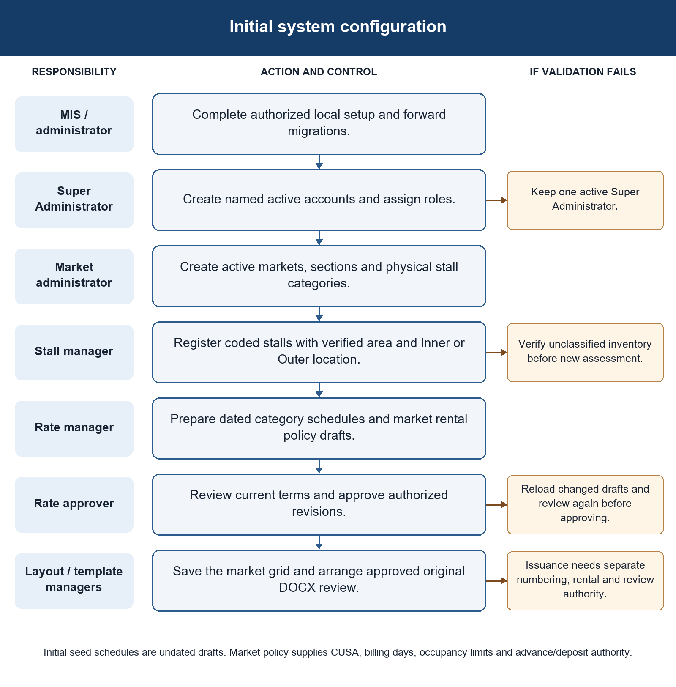

Figure W02. Recommended configuration order and approval prerequisites.

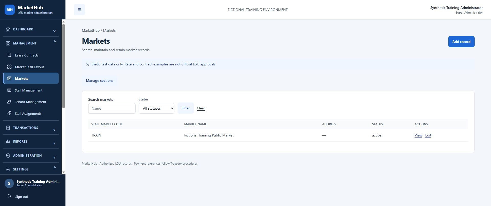

Figure 34. Actual market directory in the isolated demonstration database.

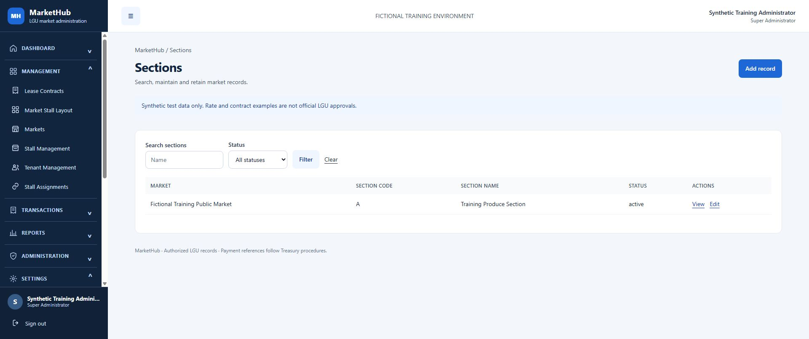

Figure 35. Actual section directory and parent-market relationships.

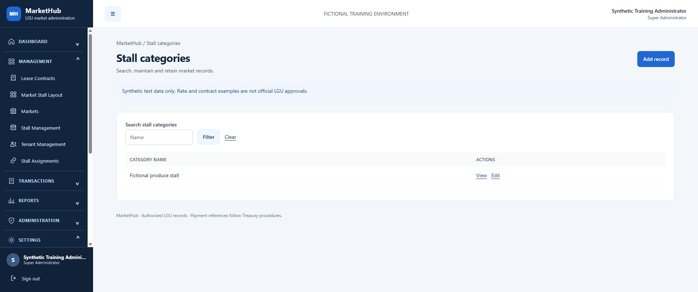

Figure 36. Actual stall-category registry.

### 4.2 Markets, sections and categories

1. Open the relevant list and select its create action.
2. For a market enter a unique code (up to 40 characters), name (up to 120), optional address and status.
3. For a section select the market, enter its unique-within-market code and name, and choose status.
4. For a category enter its unique name, up to 120 characters.
5. Save, locate the row, and use its view/edit link to verify the relationship.

**Expected response:** each location can be selected in dependent forms. **Validation:** a section containing stalls cannot change market. An occupied location cannot be deactivated until occupied assignments are ended. **Common mistake:** reusing one section code in the same market, or renaming/moving historical inventory to represent another physical location. Separate building and zone setup pages are unavailable; record floor/building text on stalls and use configured sections appropriately.

Use **Settings → Market Sections** to create or edit a section for a market. Enter its code and name, and optionally add a description and color. Set display order on the record or reorder up to 500 sections at once within one market. Counts are derived from the stalls assigned to each section. An occupied section cannot be deactivated. Section colors identify sections while occupancy colors retain their status meaning.

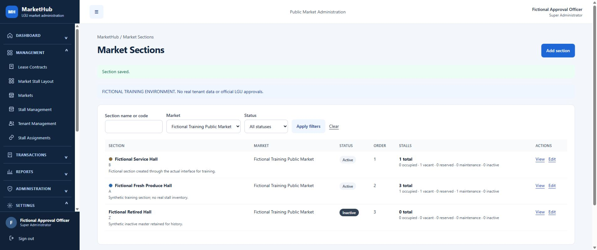

Figure 53. Market Sections list with counts and descriptions in isolated fictional data.

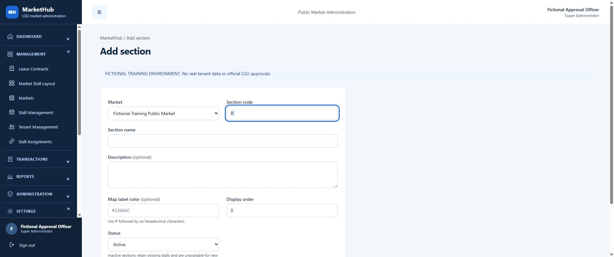

Figure 54. New Market Section form in isolated fictional data.

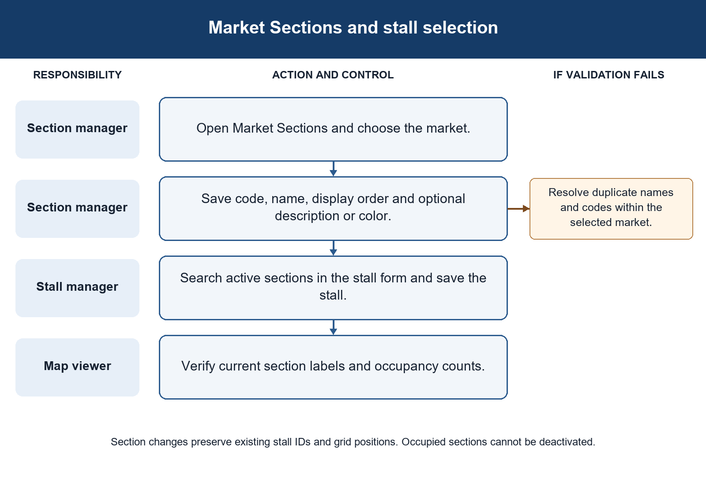

### 4.3 Business Categories and rate history

1. Open **Settings → Business Categories**. The seed contains 21 categories and undated draft schedules. The separate **Other IT related equipments/items** category shares the Cellphone rate range of PHP 34.84–40.00 per sq. m. per day.
2. Open a category’s **Rate history**. With `rates.manage`, maintain its name, stable code, description, display order and active status. Supply the authorized minimum and maximum, effective-from date, any effective-until date and official reference on the draft.
3. With `rates.approve`, review the displayed terms and select **Approve rate** only with actual LGU authority. If the draft changed after you opened it, approval is blocked by the revision fingerprint. Reopen the revision and review its current terms before approving.
4. Use **Retire revision** to give an approved revision a last effective date and reason. Prepare and approve a successor with a non-overlapping inclusive date range. The end date must cover any agreement commencement already assessed under that revision.

**Expected response:** the category shows its schedule and approval history. An active category with an eligible approved revision can support new assessments. **Validation:** rates must be positive and the maximum must equal or exceed the minimum. Undated or unapproved drafts, inactive categories and missing or overlapping effective schedules block new assessments. Approved revisions are locked against ordinary edits. **Common mistake:** applying a seeded draft before checking the effective dates and official reference.

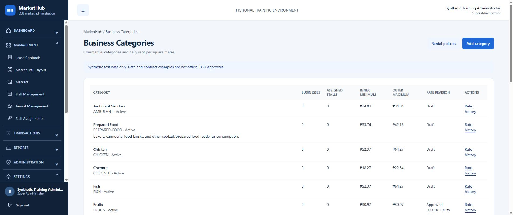

Figure 46. Business Categories in the fictional environment, with Inner minimum, Outer maximum and revision status.

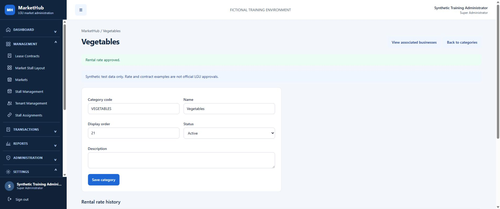

Figure 47. Category rate history and review controls in the training environment.

### 4.4 Rental Policies and legacy rates

1. Open **Settings → Rental Policies**. With `rates.manage`, prepare a dated market-policy draft with an official reference and explicit daily CUSA, including zero when authorized.
2. Choose **Calendar days** to use the actual days in each billing month, including leap years. Choose **Fixed days** only when the approved policy supplies a count, from 1 to 366. Enter that count. Additional occupancy requires an authorized maximum concurrent-assignment count. Record the advance/deposit authorization where the policy provides it.
3. With `rates.approve`, compare the displayed revision to the approved policy and select **Approve policy**. The changed-draft check and effective-range rules also apply here. Monthly assessments and concurrent occupancy need an eligible policy.

Review stored historical monthly rates in **Settings → Legacy Rental Rates**. They remain the basis for eligible legacy agreements. The **Fixed days** choice in a monthly market policy sets the day multiplier for a monthly bill. Separate fixed-day bills are available for assignments created with the opt-in feature. The ordinary single-assignment path requires an approved category rate and does not require a market policy. For installation and activation, see `docs/operations/FIXED_DAY_BILLING.md`.

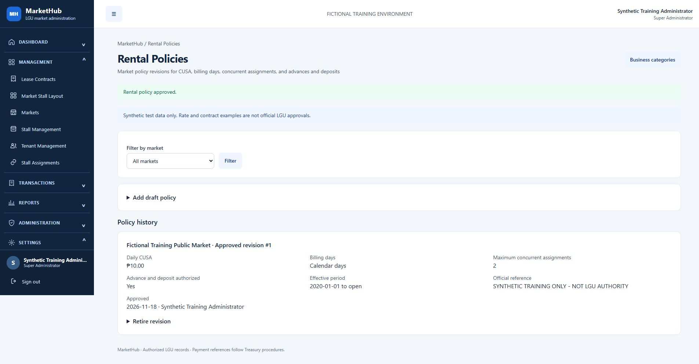

Figure 48. Rental policy revision controls in the training environment.

## Chapter 5 — Stall Management

### 5.1 Directory and registration

1. Open **Management → Stall Management**.
2. Search by stall code or use the displayed Stall location and Business category filters. The map provides market, section and occupancy filters.
3. Select a row's view action for the stored fields, or edit it if authorized.
4. To register inventory select the create action. Choose the market, a section belonging to it, and optional category.
5. Enter code, floor/building, the required classification, verified area, **Inner** or **Outer** stall location, operational status, description and remarks.
6. Save and re-open the record to check its location and area.

**Expected response:** the directory retains the stall and the map can display it. **Validation:** code is required, at most 40 characters and unique within its market. Area is required, nonnegative, at most 99,999,999.99 and at most two decimals. Classification is required. The section must belong to the market. **Common mistakes:** copying a stall code into the wrong market or guessing whether a physical stall is Inner or Outer. Existing unclassified inventory can be reviewed, and requires verified location and positive area before new assessment.

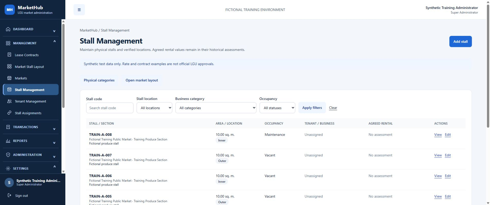

Figure 03. Stall directory and available actions.

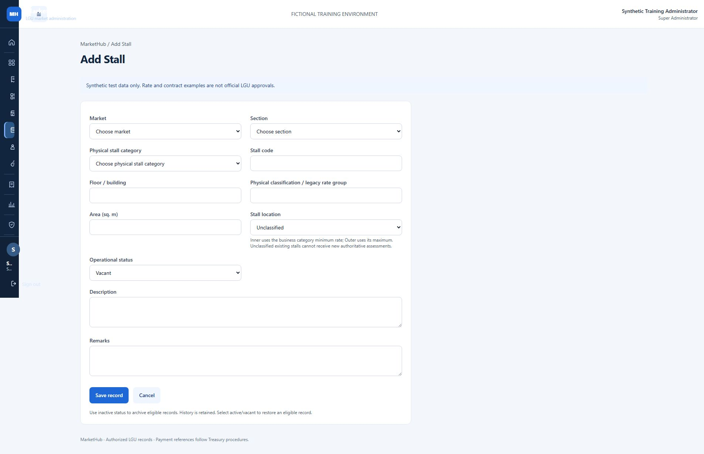

Figure 05. Actual stall form; the occupancy assignment workflow controls occupied status.

The stall form searches active sections of the selected market. If a section is missing, an authorized officer can open **Add section in new tab** in a separate tab and refresh the section options after saving. An existing stall can retain its inactive section during an unrelated edit. New links require an active section in the stall's market.

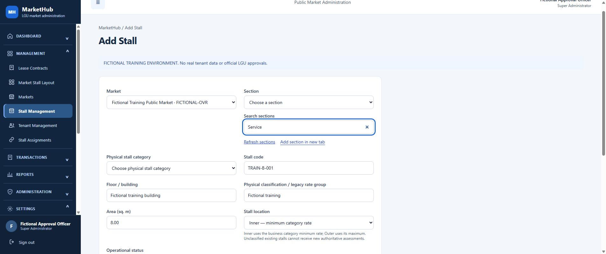

Figure 55. Searchable stall section selector in isolated fictional data.

### 5.2 Status labels and safe changes

| Label | Map color | Meaning and action |
| --- | --- | --- |
| Occupied | Green | Has current occupancy; end the assignment to release it. |
| Vacant | Gray | Available for an eligible assignment, subject to checks. |
| Reserved | Amber | Reserved inventory; the assignment workflow can accept it. |
| Under maintenance / maintenance | Red | Operationally unavailable; not eligible for a new assignment. |
| Inactive | Dark gray | Deactivated inventory; retained for history. |

1. For a vacant/reserved/maintenance/inactive stall, edit its operational status only under actual authority.
2. To occupy a stall, create an assignment; do not imitate occupancy by editing a label.
3. To release an occupied stall, end or transfer the active assignment under Chapter 7.
4. To return an eligible inactive stall to service, edit it to vacant after authorization and inspect its history.

**Expected response:** the directory and map use the saved operational status. **Validation:** **“End the active assignment before changing occupancy.”** Stalls with history cannot change market, section or classification. A verified correction to area or Inner/Outer location on a stall with history requires a reason. Historical assessments preserve their earlier location and area. **Common mistake:** treating green as “fully paid.” All colors represent operational occupancy; payment status and balances are separate.

### 5.3 Interactive layout and detail panel

1. Open **Management → Market Stall Layout**.
2. Select market, optional section, occupancy status or stall location. Users with tenant access can also filter by business category. Select **Apply filters**.
3. Select a stall tile. Verify current location and area. Historical assessments can show different assessed values when master data was later corrected.
4. If permitted, inspect the tenant and business, assessed rate, reference-period rent, CUSA, posted balance, lease status and recent payment or assignment history. On a fixed-day assignment, CUSA appears for reference and the payable amount is period base rent.
5. Use the available detail-panel links to open full tenant, assignment, billing or payment records.

**Expected response:** the side panel loads server records for the selected stall. It shows only information your permissions allow; the viewer role does not gain tenant or payment detail merely by seeing the map. The panel limits assignment history to ten records and effective recent payments to five; use full lists for more. **Validation:** no matching tiles can mean the filters exclude all stalls. **Common mistakes:** reading the previous selection while a request is loading or expecting the latest payment for a stall to represent only today's tenant. Stall history can include earlier occupancy.

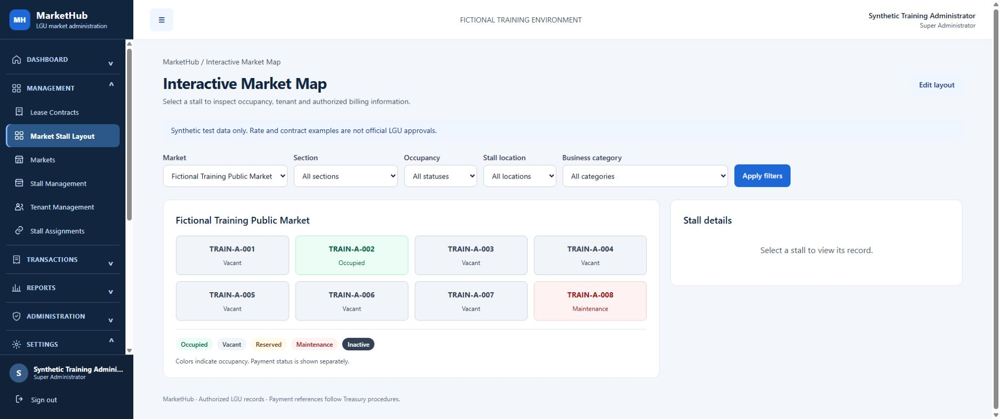

Figure 04. Actual grid layout, occupancy legend and selected-stall panel.

For officers with access to rental information, use **Rental reference month** and **Rental computation** to inspect applicable terms. The detail panel distinguishes the current section from the section saved in the initial assessment. The map preview is separate from issued assessments and posted balances.

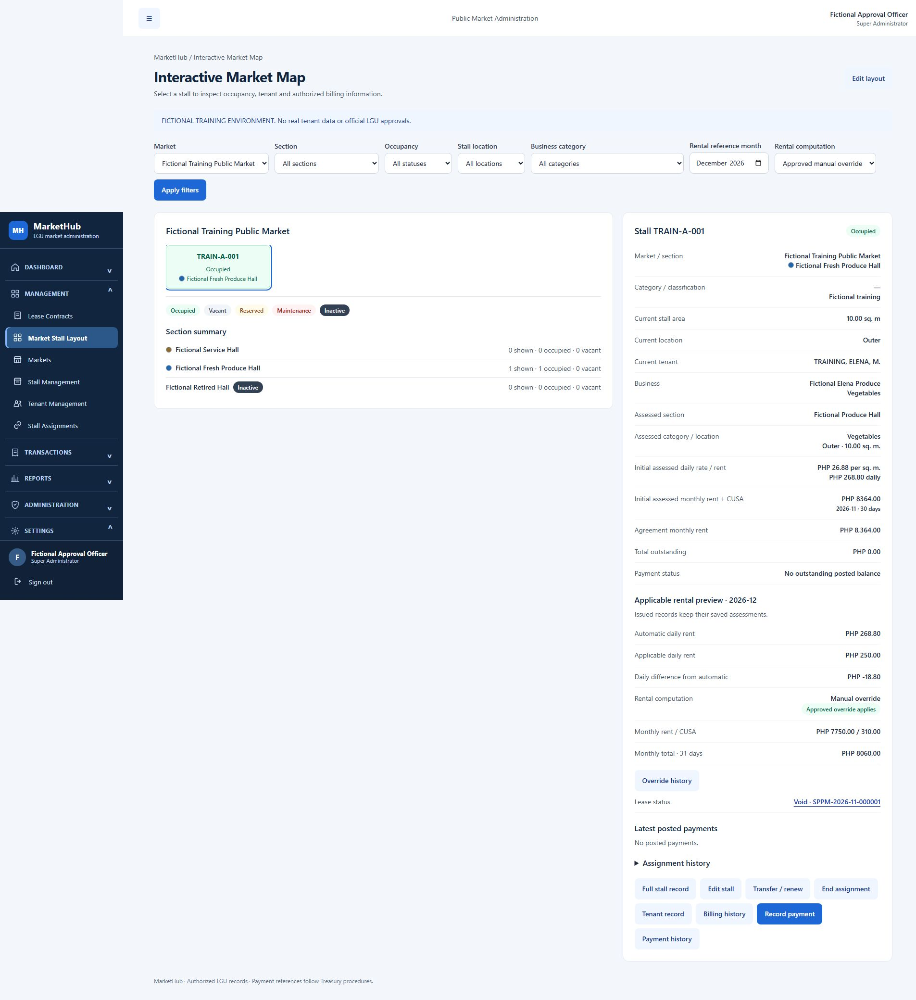

Figure 63. Map showing current and assessed sections and the applicable rental preview in isolated fictional data.

### 5.4 Edit the grid layout

1. With `markets.manage`, select **Edit layout** for the chosen market.
2. Set layout columns (1–40) and rows (1–100).
3. Enter each stall's row, column, width and height; width/height range from 1 to 10 grid cells.
4. Include every stall in that market exactly once; check that rectangles do not overlap and stay inside the grid.
5. Save and refresh the map to verify the arrangement.

**Expected response:** **“Layout saved.”** The server retains positions after refresh. **Validation:** **“Submit every stall in this market exactly once.”**, **“A stall extends beyond the layout.”**, or **“Stalls cannot overlap.”** **Common mistake:** treating the grid as a scaled architectural plan or looking for a drag-and-drop editor. This is a form-based grid, and geometry does not change the stall's recorded floor area.

## Chapter 6 — Tenant Management

### 6.1 Register and verify a tenant

Open **Management → Tenant Management → Register tenant**. Use the seven sections in order. You can save a verified tenant without a stall selection.

1. **Personal:** enter verified last and first names, middle name/initial where supplied, civil status, gender, citizenship, residential address and contact information.
2. **Identification:** enter previous and present account numbers as text, preserving leading zeroes. Record verified government-ID information and issuance details or a documented exception where supported.
3. **Businesses.** Add one or more businesses under the same tenant. Select an active business category for a business that will use a stall. Enter trade information, permitted goods or services, permit reference and registration reference when available. Staff can confirm an otherwise eligible assignment with these reference fields and the permitted goods or services blank.
4. **Stall selections.** For each intended assignment choose the business and an eligible classified stall. Enter the start date and any end date. Registration generates the agreement reference. If fixed-day fields are available, check the suggested interval and enter optional daily CUSA for the record. For additional occupancy, enter the reason and provide the authorization reference if available. Effective policy approval is still required.
5. **Rental preview.** Verify the category, stall area and location, approved minimum and maximum, applied daily rate and billing basis. In a fixed-day preview, verify the selected day count, base rent payable and any record-only CUSA. See Chapter 7 for the calculation.
6. **Helpers:** enter up to two helpers for each pending assignment.
7. **Review:** select **Save draft** if more evidence or assignment authority is needed. Select **Confirm registration** after review if authorized. This saves the tenant and any submitted assignments together. Contracts are prepared separately.

**Expected response:** **“Registration draft saved.”** or **“Tenant saved.”** A blank tenant reference is generated on creation. Structured names display as `LAST NAME, FIRST NAME, M.I.`. **Validation:** drafts keep pending selections without reserving a stall. Confirmation rechecks ownership, eligibility, authority and calculation. A failed confirmation rolls back the related save. The next officer can use **Resume registration** and recheck eligibility. **Common mistakes:** assuming a preview guarantees availability, or attempting to confirm a draft with pending assignments while signed in as Market Staff.

After a server validation error, read **Please check the following** and follow an error link to its field when a link appears. Review messages without links in the relevant section or resolve the record or permission issue they describe. Re-enter any protected ID value required for the correction before resubmitting.

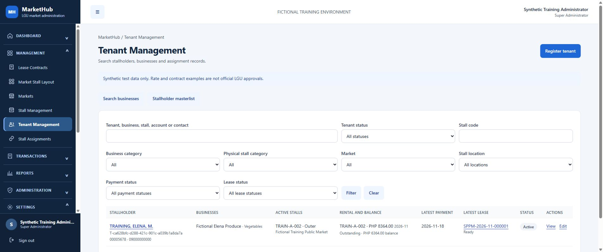

Figure 06. Tenant Management search and relationship filters.

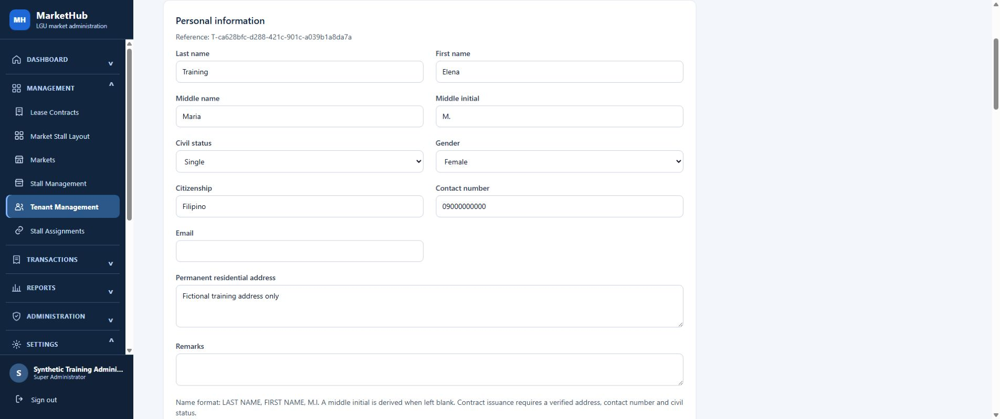

Figure 49. Monthly training example of the unified registration form.

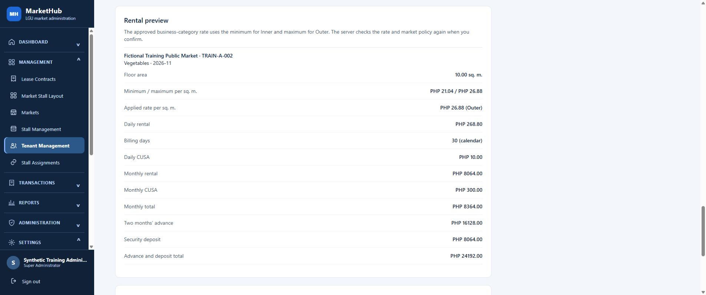

Figure 50. Monthly training preview for an Outer stall of 10 sq. m. under the Vegetables category.

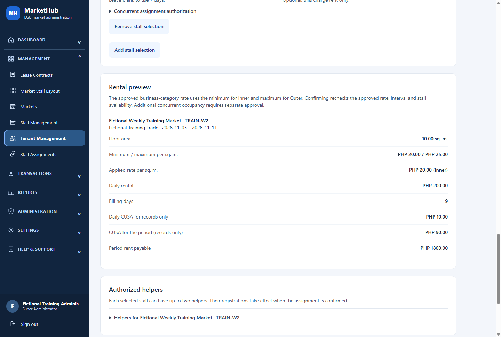

Figure 68. Fictional nine-day registration preview. The period is 3–11 November, base rent payable is PHP 1,800.00 and record-only CUSA is PHP 90.00.

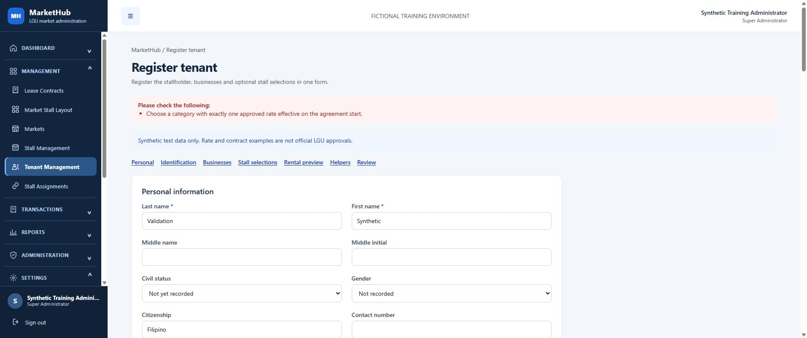

Figure 08. Validation feedback from the isolated demonstration.

### 6.2 Tenant data dictionary

“Optional” below describes saving a tenant profile. Contract generation imposes stricter completeness checks described in Chapter 7. Dates use `YYYY-MM-DD`. Text limits are server limits; long text still requires document layout review.

| Field / group | Required to save | Format and validation / treatment |
| --- | --- | --- |
| Reference | No | Unique text up to 60 characters when supplied. A new profile gets a `T-` reference if blank. Leaving the field blank on edit preserves the saved reference. |
| Last name; first name | Yes on new profile | Text, each at most 100; supplying either structured field requires both. |
| Legacy full name | Retained | Existing unsplit name is preserved when both structured fields remain blank; max 255 if explicitly supplied. |
| Middle name; middle initial | No | Text max 100 / 10; initial normalized with period; formatted full name max 255. |
| Civil status | No | single, married, widowed, separated, other; current template generation supports Single/Married only. |
| Gender | No | female, male, other, prefer_not_to_say from configuration. |
| Citizenship | No | Text max 100; Filipino default does not replace verification. |
| Contact number | No | Text max 40; no numeric-only conversion. Required for contract generation. |
| Email | No | Valid email max 255 server-side; form input is shorter. |
| Permanent residential address | No | Text max 2,000; required for contract generation. |
| Previous / present account number | No | Text max 120 each; duplicates allowed; retain leading zeroes. |
| Government ID type | No | Text max 100 server-side; required for generation. |
| Government ID number | No | Text max 120; stored encrypted, restricted display. Blank on edit preserves existing number. |
| Government ID date issued | No | Valid date, no later than today. |
| Government ID place issued | No | Text max 255. |
| ID issuance exception reason | No | Text max 2,000; records a legitimate omission, never an invented date/place. |
| Status | Managed by workflow | Draft registrations become active on confirmation. Active tenants can be set inactive or archived after their active assignments end. |
| Remarks | No | Text max 2,000; do not use as a password or unnecessary ID repository. |
| Helper assignment | Required to save helpers | Choose a pending assignment in registration or an existing assignment of this tenant in edit. |
| Helper full name | Optional slot | Max 150; blank slots do not become named helpers. |
| Helper relationship; phone | No | Max 100 / 40. |
| Helper registration status | If provided | authorized or inactive; only authorized helpers enter a new contract snapshot. |
| Helper remarks | No | Max 2,000; at most two helper slots per assignment. |
| Source individual/name sequence | Reconciliation only | Nullable text retained for future source matching; not guaranteed unique identity. |

### 6.3 Search, profile and updates

1. Search by tenant or business name, stall code, account number or contact. Check potential duplicate matches against verified details before adding a tenant.
2. Filter tenant status, business category, physical stall category, market or stall location. Payment and lease status require the applicable permissions. Stall-related filters can match historical assignments.
3. Open a profile. Its nine tabs are **Overview**, **Personal Information**, **Businesses**, **Stall Assignments**, **Rental Information**, **Authorized Helpers**, **Payment History**, **Lease Contracts** and **Activity History**. Your role controls which tabs you can open. Rental and payment figures come from the authorized assessments and ledger.
4. Select **Edit tenant** to update verified current information. A blank government ID number keeps the existing value. A draft instead offers **Resume registration**.
5. Arrange authorized ending of active assignments before deactivating or archiving a tenant.

**Expected response:** the tenant has one profile and one list row with related business and assignment summaries. **Validation:** **“End active assignments before archiving or deactivating this tenant.”** **Common mistake:** creating a second tenant based on a typo or treating a shared account number as proof that records should be merged.

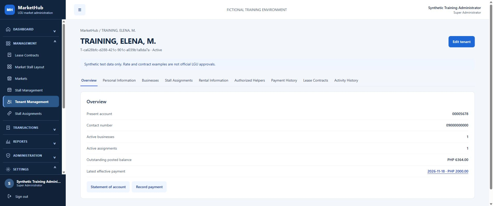

Figure 51. Fictional tenant profile and its tabs as seen by the training administrator.

### 6.4 Businesses and assignment helpers

1. Open the tenant profile’s **Businesses** tab. Use **Register business** or **Edit business**. The Tenant Management page also provides **Search businesses**.
2. Check the category, line of business, permitted goods/services, permit and registration references, dates and status. Select an active category for a business intended for a new assessment. Legacy free-text categories can be reviewed for reconciliation.
3. End any active assignments for that business before archiving it. Business ownership is fixed through ordinary editing.
4. In **Edit tenant**, select the correct existing assignment in the Helpers section. Record up to two verified names, relationship/contact details, status and remarks. Confirm the saved records in **Authorized Helpers**.

Permitted goods or services and business permit and registration references are optional for an assignment. A supported monthly lease draft still needs 1–180 characters of verified goods or services in the frozen assessment. If staff originally assigned the stall with this field blank, record the verified details on the business and complete an eligible renewal to capture them for the future lease. The original assessment remains part of the record. Each helper belongs to one assignment. Only authorized helpers enter a contract snapshot.

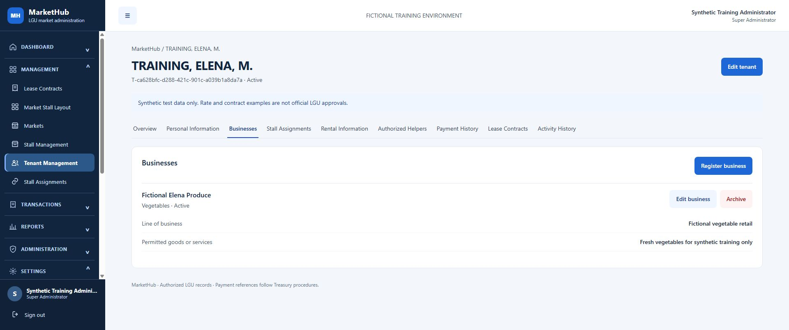

Figure 52. Businesses linked to the fictional tenant from the profile.

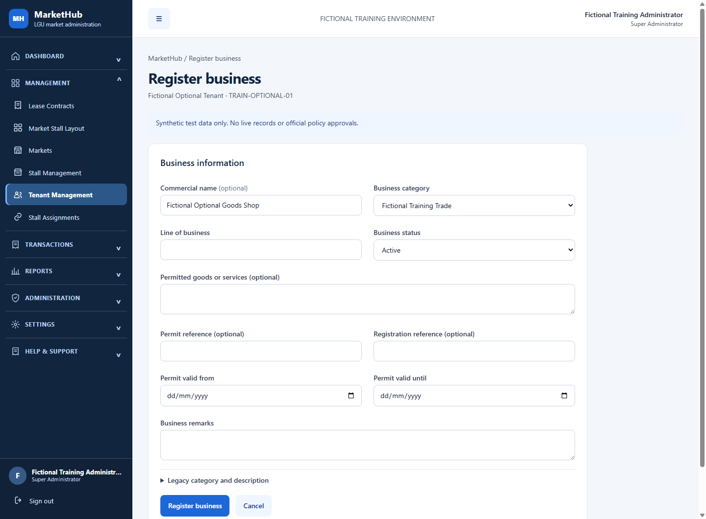

Figure 72. Fictional business registration with an active category and blank permitted goods or services, permit reference and registration reference.

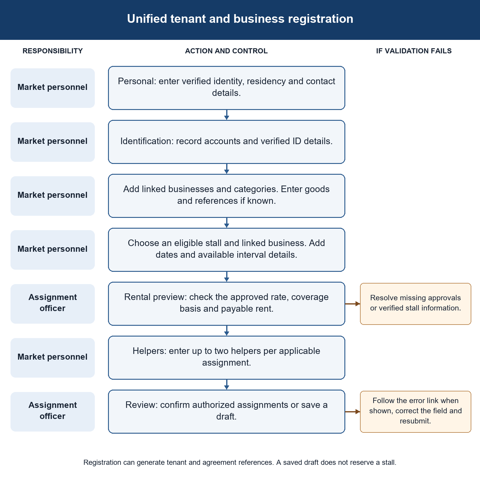

Figure W03. Unified registration, validation and linked records.

### 6.5 Inventory workbook mapping — all 21 source columns

The original private `INVENTORY OF STALLHOLDERS.LEGAL.xlsx` is a reference, not a file to upload through a nonexistent import page. Its `masterfile.rpt` worksheet contains grouped/merged rows, continuation lines, formulas and stored values. Source counts are not verified tenant totals. No real workbook records were imported for this manual. An authorized future import needs preview, duplicate resolution, displayed account formats, explicit stall matching and formula reconciliation.

| Column | Exact source header | Application destination / rule |
| --- | --- | --- |
| A | INDIVIDUAL SN | Tenant source individual sequence; nullable text, not approved unique key. |
| B | SN ACCDG TO NAME | Tenant source name sequence; duplicates permitted. |
| C | PREV ACCT NO. | Previous account number as text. |
| D | PRES ACCT NO. | Present account number as text; never infer from previous. |
| E | # OF STALL PER CATEGORY | Assignment source stall count; do not multiply continuation rows. |
| F | ACTUAL REGISTERED STALL PER CATEGORY | Assignment registered source count; distinct from application assignment count. |
| G | NAME | Preserved legacy tenant name; verified structured conversion only. |
| H | ADDRESS | Permanent residential address. |
| I | CODE | Match existing stall code within its market; reject ambiguous/missing match. |
| J | #S | Assignment source sequence; not tenant identity. |
| K | StallCategory | Approved existing stall category matching. |
| L | AREA | Stall area and applicable contract area snapshot; no silent historical overwrite. |
| M | RENTAL/SQM | Source comparison value. For a new assessment the approved business-category schedule and stall location determine the applied rate. |
| N | DAILY CUSA | Compare with the effective approved market rental policy. |
| O | DAILY RENTAL | Recalculate area × daily rate per square meter. |
| P | # OF DAYS | Compare with calendar or fixed days under the approved policy. |
| Q | MONTHLY CUSA | Daily CUSA × billing days. |
| R | MONTHLY RENTAL | Daily rental × billing days. |
| S | 2-MOS ADV | Two × base monthly rental, excluding CUSA; calculation is not payment posting. |
| T | SECURITY DEPOSIT | One × base monthly rental, excluding CUSA. |
| U | TOTAL (2 MOS ADVANCE + DEPOSIT) | Advance plus security deposit; does not create a receivable/payment. |

Attendance-sheet time/signature fields remain attendance-only; there is no attendance module. Source formulas and cached totals do not establish current approved policy. Preserve private XLSX/DOCX originals and consult `docs/TENANT_FIELD_MAPPING.md` before any authorized data migration.

## Chapter 7 — Lease and Contract Management

### 7.1 Assign a stall and review the rental assessment

1. With MA or SA, open **Management → Stall Assignments → Assign a tenant**, or confirm the pending selections in unified registration.
2. Choose an eligible vacant/reserved stall, active tenant and the tenant’s active business with an active category.
3. Enter the start date and any end date or remarks. You can supply a unique **Agreement reference** or leave it blank to generate an internal `RA-` reference. If available, choose a **Billing interval (days)** of 1 to 366. The installation suggests seven days unless MIS configures a different default. Enter **Daily CUSA for records only (PHP)** when applicable. If the assignment adds concurrent occupancy, enter the reason and an authorization reference if available. On the proposed start date, the effective policy of every involved market must permit the tenant’s total concurrent assignments.
4. Save. Inspect the agreement under the profile’s **Stall Assignments** and **Rental Information** tabs. Check the stall’s occupied status on the map.

**Expected response:** the application saves the assignment, agreement and immutable rental assessment together. **Validation:** active market and section, eligible dates, no conflicting occupancy, verified Inner or Outer classification, positive area and an effective approved category rate are required. Monthly assessments and concurrent occupancy additionally require an effective approved market policy. Pending choices can stay in a registration draft while awaiting approvals. **Common mistake:** assuming that a policy for one market allows the tenant to exceed another involved market’s limit.

| Calculation | Approved basis |
| --- | --- |
| Applied daily rate per sq. m. | Inner uses the approved category minimum. Outer uses the approved maximum. |
| Daily base rental | Applied rate × verified floor area, rounded half-up to two decimals. |
| Base monthly rental | Daily base rental × approved billing days. |
| Monthly CUSA | Approved daily CUSA × approved billing days. |
| Monthly total | Base monthly rental + monthly CUSA. |
| Advance rental | Two base months, excluding CUSA. |
| Security deposit | One base month, excluding CUSA. |
| Total initial advance and deposit | Advance rental + security deposit. |

The assessment freezes the business/trade, category, stall location and area, rates, policy references, billing-day rule and reference-period figures. Historic assessments stay intact after master records change. With a calendar-day policy, a different month can produce a different total using the same frozen basis. Advance and deposit calculations are information for review.

For fixed-day assignments, multiply rounded daily base rent by the saved interval to get the payable amount. Any recorded daily CUSA is multiplied by the same interval and displayed for reference. Fixed-day assessments do not assess an initial advance or deposit. Adjust the interval on creation or an eligible renewal. The saved original term and its bills retain their coverage and amounts.

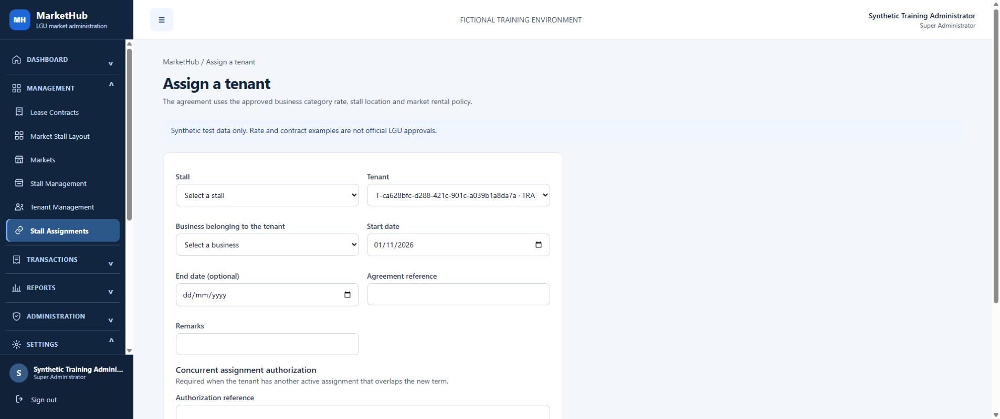

Figure 27. Stall assignment form for an existing tenant in the monthly training example.

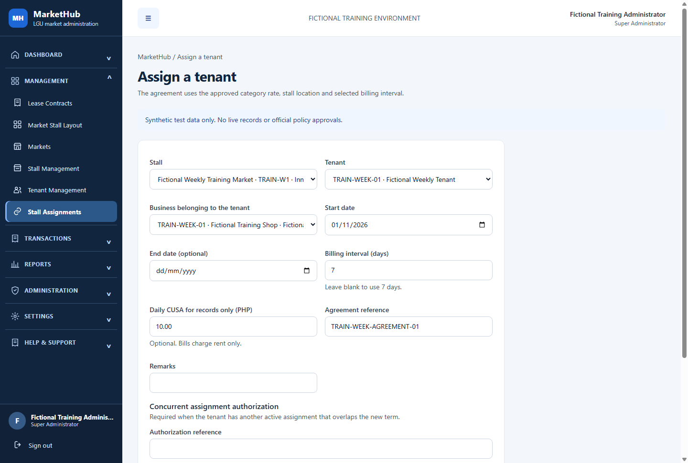

Figure 67. Fixed-day billing training example from v1.4, showing a seven-day interval and PHP 10.00 daily CUSA for records.

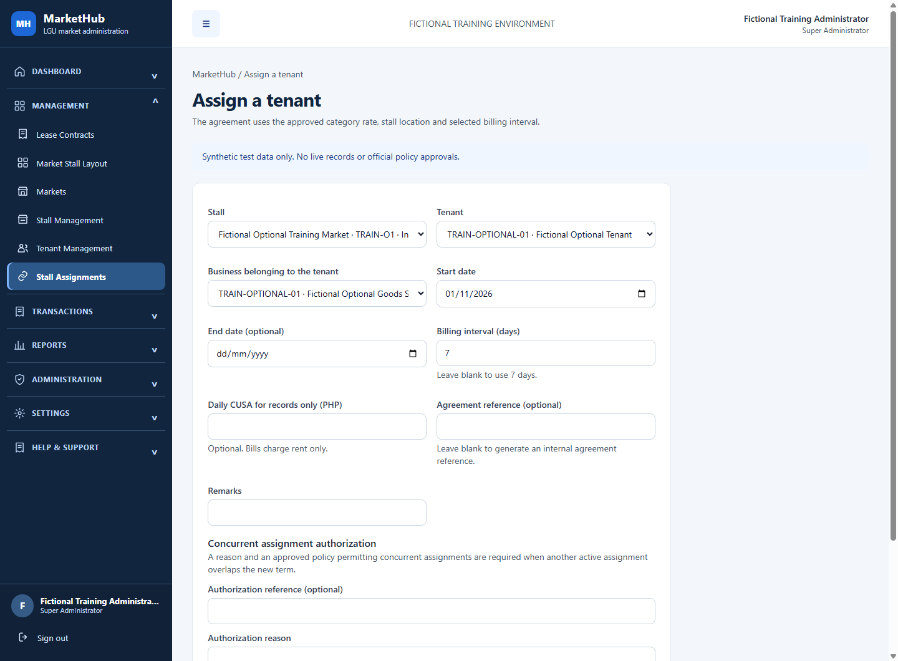

Figure 71. Fictional assignment form. A blank agreement reference generates an internal reference on save. Concurrent occupancy still requires a reason and approved capacity.

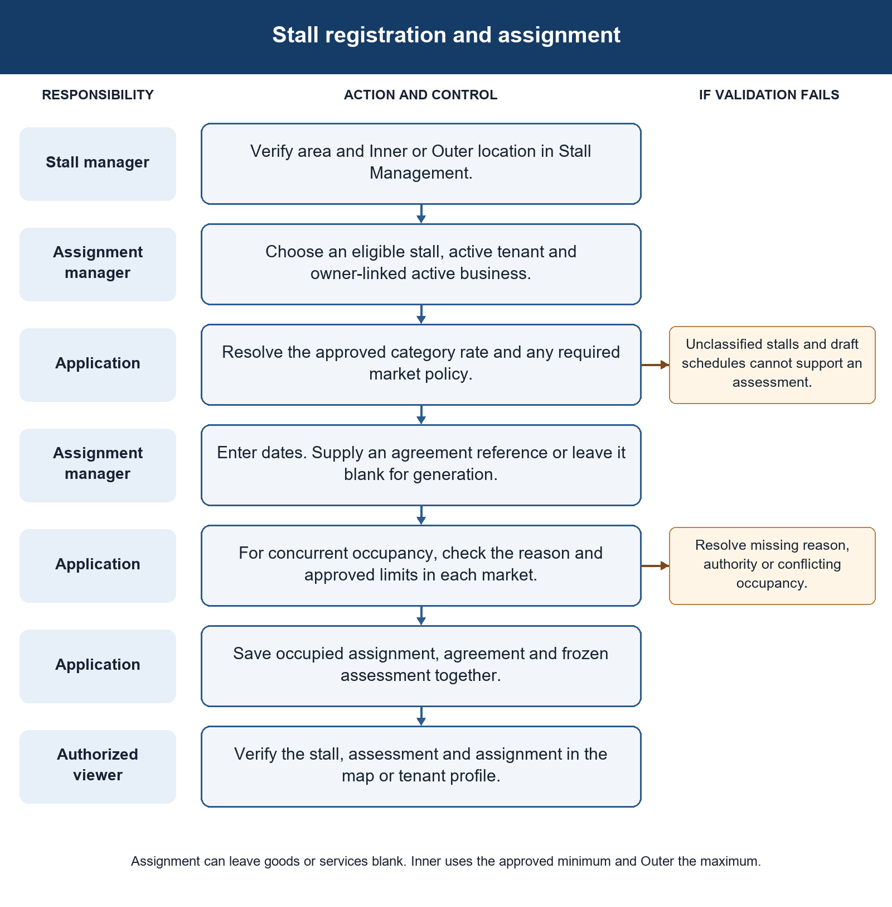

Figure W04. Stall assignment, authority checks and the frozen rental assessment.

### 7.2 Register and approve a template

Only an officer with the separate template permissions can perform this task. New drafts use the unchanged private `v04_San_Pedro_Public_Market_Lease_Template.docx`; the earlier v02 source and issued files remain for history. Registration prepares a separate working copy. Authorized staff must inspect all nine pages and resolve the source's invalid sample date and `INNER/CORNER` label against the application's `Inner/Outer` classification before approving v04. The form does not accept an arbitrary uploaded replacement.

1. Open **Settings → Contract Templates**.
2. Enter a unique version and descriptive name; register a private working copy.
3. Download it and compare with the authoritative source in an approved compatible document application.
4. Have the duly authorized reviewer verify legal wording, logo, fields, all pages, tables, signatures and notarial blanks.
5. Only after real review, enter approval reference/effective date, attest to visual verification and approve.

**Expected response:** registered versions appear in the list; approved versions become selectable for drafts. **Validation:** missing authoritative source returns an error; version must be unique; approval reference, effective date and accepted visual-review confirmation are required. **Common mistakes:** checking the attestation merely to enable a button, editing source legal wording to fit a screen, or assuming test success verifies the target nine-page layout. Successful Word/page-by-page fidelity is a separate acceptance task.

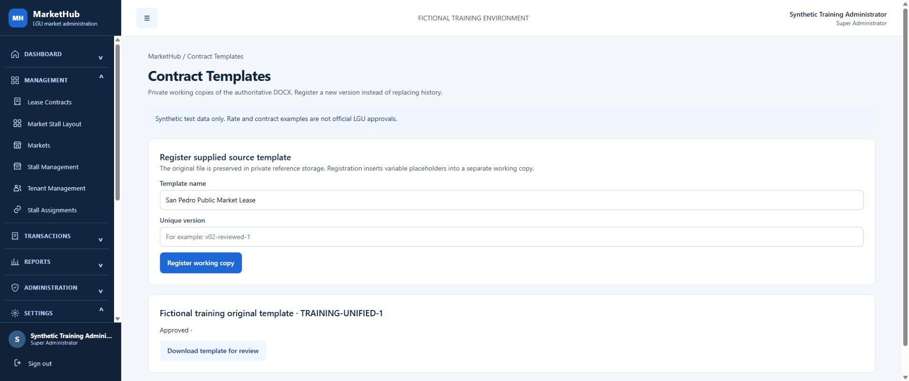

Figure 14. Template registry; the training screen does not grant legal or policy approval.

### 7.3 Create and calculate a lease draft

1. Open **Management → Lease Contracts** and select the create-draft action. You can also select **Prepare lease contract** from the active tenant’s **Lease Contracts** tab to show only assignments for that tenant.
2. Select an active monthly assessed assignment and the approved v04 template version. The assessment must contain 1–180 characters of verified permitted goods or services. If the saved assessment lacks this information or the business details have changed, record the verified current details and use an eligible monthly renewal before creating the draft. A legacy assignment also needs an eligible monthly renewal. Fixed-day assignments need a separately approved compatible contract workflow.
3. Enter effectivity, expiration and execution dates. Contract dates must fall within the assignment.
4. Select **Save draft**. Review the permitted goods, location, area, applied rate, billing days, base rent, CUSA and initial advance/deposit breakdown. The effectivity month is the contract’s reference billing period.

**Expected response:** the draft uses the agreement’s frozen business and rental basis. **Validation:** expiration must follow effectivity and overlapping in-force lease records are rejected. Relevant changes to business details require an authorized renewal before drafting a new contract. **Common mistake:** using the draft to change assessed trade details, rent, CUSA or billing days.

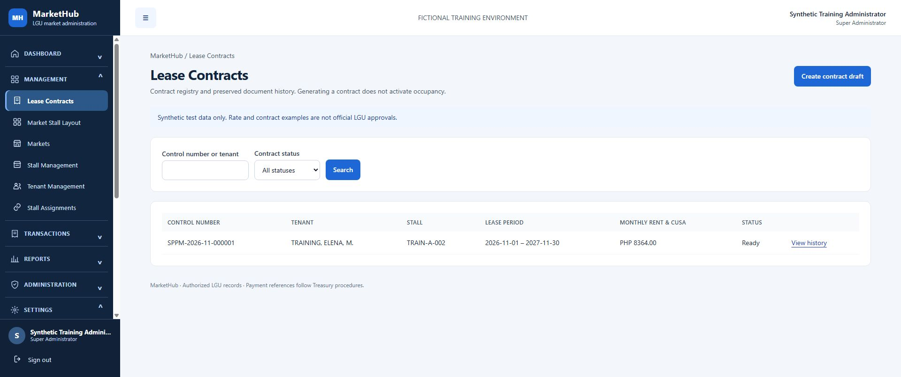

Figure 10. Lease Contracts registry with search and status controls.

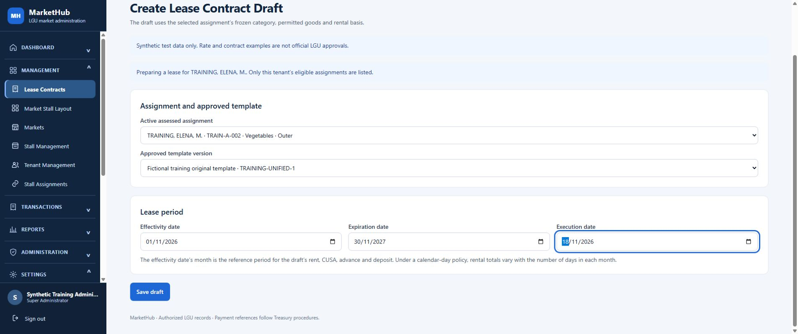

Figure 11. Lease draft form for an active assessed assignment, approved template and lease dates.

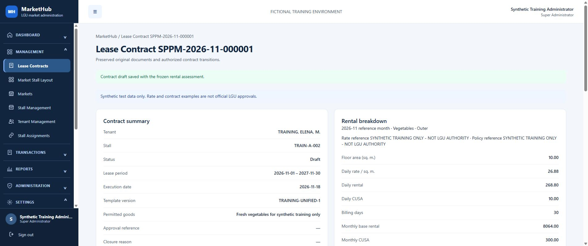

Figure 12. Saved lease draft showing the assessed basis and calculation for review.

### 7.4 Generate, review, download and print

1. With `contracts.generate`, verify the current tenant names, address/contact, government ID and issuance details or documented exception. Verify the current authorized helpers for the assignment. First generation captures these details in the contract while using the frozen assessment for the business and financial terms.
2. Confirm the source-template lessor name shown by the application. Supply only verified optional lessor identification details; leave unknown notarial facts blank.
3. Select **Generate DOCX** and confirm the dialog.
4. Download **Original DOCX**. Open it in a compatible document application and inspect every page against the authoritative source.
5. If **Printable PDF** exists, inspect it too; otherwise use Word to inspect/print the original DOCX. **Download for printing** uses the preserved file and records a print action; it is not an embedded Word editor.
6. Refer any page overflow, long names, changed signatory requirement, unsupported civil-status mapping or financial inconsistency for authorized review before approval.

**Expected response:** the contract moves from `draft` to `ready` and retains an encrypted immutable snapshot and original document with checksum. Reprints retrieve the same preserved original, including for previously generated legacy contracts. **Validation:** approved template must be effective on execution date; changed checksum blocks use; only a draft can generate. The template supports Single/Married; other civil statuses require an authorized template mapping. **Common mistakes:** treating `ready` as issued or approved, typing fictional signatory authority, or claiming the converter exists because a PDF button appears elsewhere in the application.

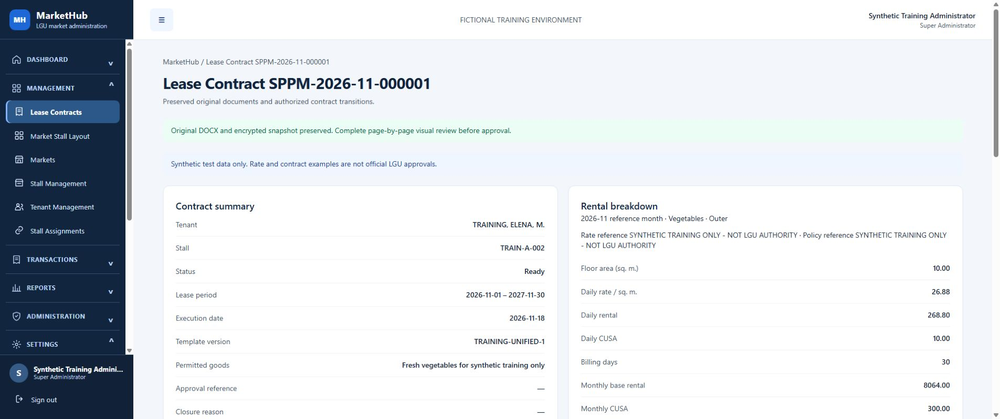

Figure 13. Generated-document `ready` stage, preserved download controls and review gate; not proof of authorized issuance or Word layout acceptance.

### 7.5 Controlled issuance and closure

1. The authorized reviewer opens a ready document, completes the real page-by-page comparison, enters the review reference and selects **Approve reviewed document**.
2. The issuance officer confirms approved numbering and rental-policy references are configured by MIS, checks the assessed policy’s advance/deposit authorization and verifies eligibility before selecting **Issue contract**.
3. After real execution, an authorized officer uploads the actual signed PDF/JPG/PNG, up to 15 MB. No signature is simulated.
4. The issuance officer activates the signed contract only when its dates currently cover today.
5. After the term elapses, use eligible expiration. To close a contract by voiding or terminating it, enter a specific reason of 10–1,000 characters and select **Void contract** or **Terminate contract**. Read the dialog title and confirm the named action. Select **Cancel** or press Escape to return to the form before deciding.
6. Separately process occupancy ending/transfer; document closure does not release the stall.

**Expected response:** issue → signed → active are separate statuses; approval is an approval timestamp/reference while status remains ready. Expire, terminate and void retain history. **Validation:** issuance requires approved document review, configured numbering and rental-policy references and the applicable advance/deposit authorization; no issuance of an elapsed lease; no activation without signed file/current dates. **Common mistakes:** regarding a checkbox as approval authority, uploading an unsigned draft as signed, or assuming “Terminate contract” makes the stall vacant. The screen exposes expiration for active contracts; service rules also recognize elapsed issued/signed records, but no automatic expiry job is provided by this interface.

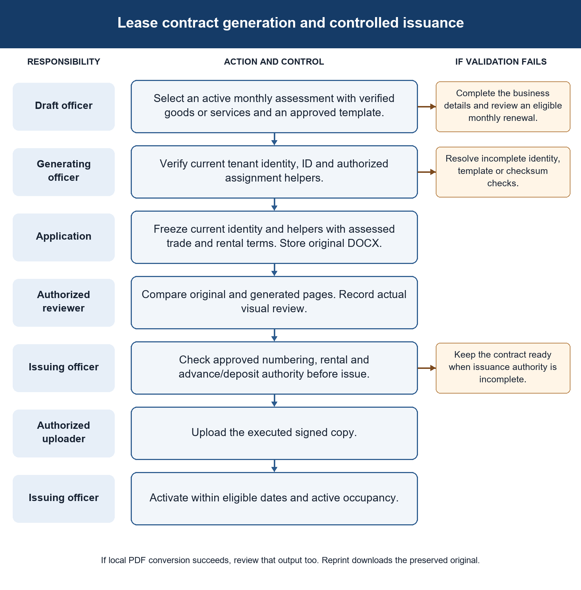

Figure W05. Contract generation, real review, policy gates and controlled document states.

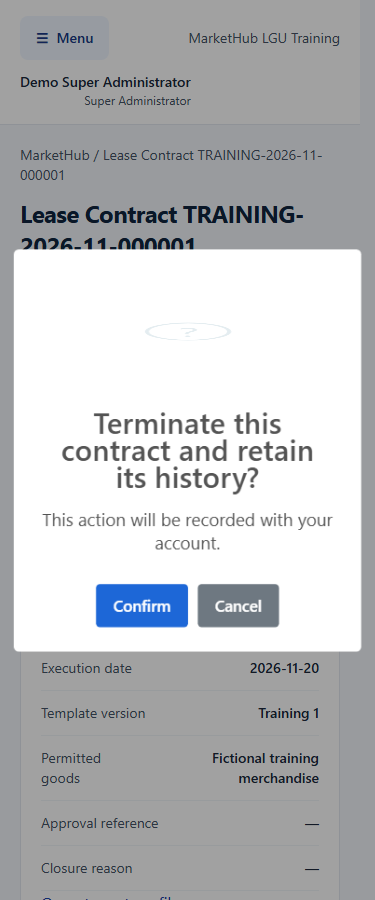

Figure 66. The termination confirmation names the selected action. This fictional prompt was cancelled.

### 7.6 End, transfer or renew an assignment

1. Review existing bills and dates before changing occupancy.
2. For ending, open **Stall Assignments**, enter an eligible end date no later than today and a reason of at least five characters.
3. For transfer or renewal, open **Transfer / renew** and choose the destination stall. Use the same stall for renewal. Choose the tenant’s eligible business, enter the new dates and provide the transfer or renewal reason. The application generates an internal agreement reference if the reference field is blank. If the new term adds concurrent occupancy, supply its authorization reason and check approved capacity in each involved market. The new term takes a fresh assessment.
4. Choose a start after the original start and no later than today. For an original monthly assignment, use the first day of a month. For an original fixed-day assignment, choose a date aligned to the original assignment start and saved period length. If MIS has disabled fixed-day entry and the renewal will be monthly, the date must also be the first day of a month. The previous assignment ends on the preceding day. If fixed-day entry is available, review the interval and record-only CUSA for the new term.
5. Confirm that old history remains and the new agreement is separate. Prepare any new legal contract through its own reviewed workflow.

**Expected response:** ending sets the stall vacant and retains assignment/agreement history. Transfer/renewal records separate history. A same-stall renewal ends and reassigns occupancy in one transaction. **Validation:** a saved bill's complete coverage must fit within the assignment. A full-month bill blocks a midmonth end when it covers a later date. An existing fixed-day bill protects its inclusive coverage in the same way. **Common mistake:** assuming bills disappear when occupancy ends.

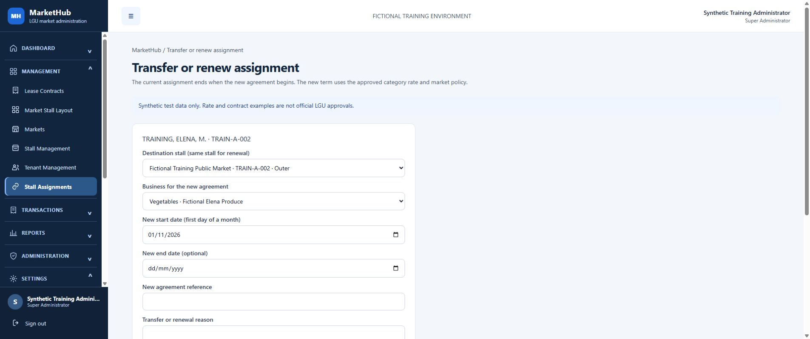

Figure 39. Earlier monthly transfer and renewal example showing the date controls.

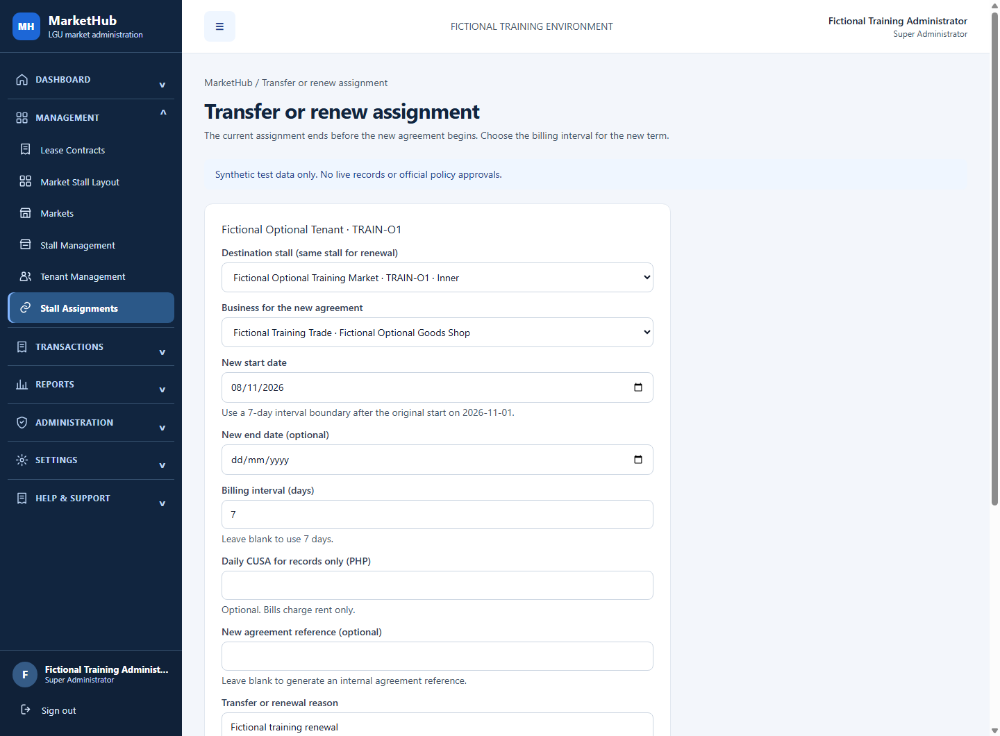

Figure 73. Fictional same-stall renewal on an eligible fixed-day boundary with the new agreement reference field blank.

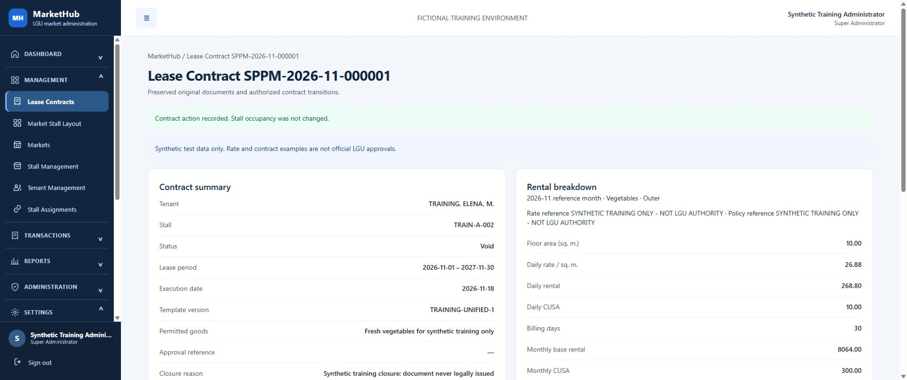

Figure 40. Actual controlled void of the synthetic contract with retained history; it does not end the separate occupancy assignment.

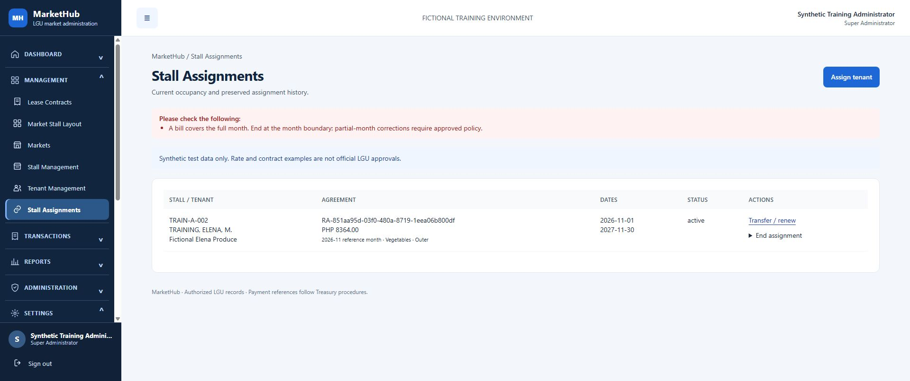

Figure 41. Actual validation preventing midmonth occupancy ending while a full-month bill exists. No bill-void workaround is provided or implied.

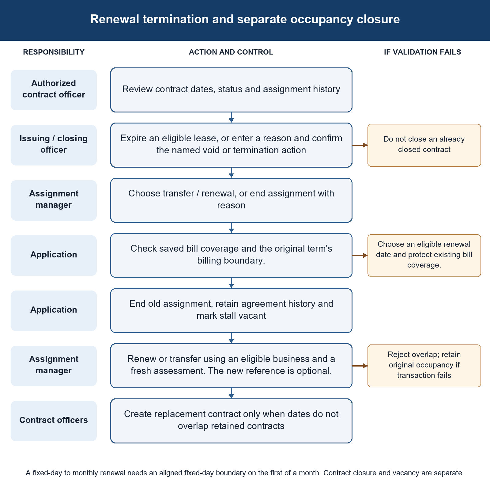

Figure W07. Separate contract closure, assignment ending and renewal/transfer controls.

### 7.7 Request, review and return to automatic rent

For a monthly assignment, open **Tenant Management → tenant → Rental Information**. Pick a **Reference month** for the assignment. **Automatic** is the default and uses the frozen initial assessed category, location, floor area and rental policy basis. Select **Manual override request → Continue** to propose new terms for that assignment. Use **Override history** to review requests and decisions. This override workflow applies to monthly assignments.

1. Choose **Rate per square meter** or **Direct daily amount**. The first is multiplied by the frozen floor area. The second is already a daily total. Enter only the amount for the selected method.
2. Choose prospective full billing months within the assignment. Start on the first day of a month and end on the last day of a month. An open end requires an open-ended assignment and policy. Enter a reason and the supporting reference where required.
3. **Preview proposed rent**, then **Save draft** or **Submit for review**. In history, use **Submit saved draft** to send a saved draft. Draft and pending requests leave applicable rent automatic unless another approved override covers the month.
4. An authorized officer other than the requester reviews the exact proposal and policy displayed in history. The policy must cover the entire requested period. For rent outside the approved category range, confirm the explicit out-of-range grant and authority reference. Zero rent also needs the explicit exemption grant. Both exceptions require a supporting request reference. Approve or reject with the available actions. If terms changed since opening the review, reload and review again.
5. An approved request applies only to covered periods on that assignment. **Return to automatic** requires a prospective full-month boundary and a reason. Expiry and revocation use the frozen automatic basis again. An ended assignment stops applying the override and a successor assignment does not inherit it.
6. Existing financial and contract snapshots keep their saved values. A new contract must have consistent rental terms across its term. A direct daily amount that cannot be reproduced using its two-decimal equivalent rate and frozen area blocks DOCX generation and issue. CUSA, billing days, advance and deposit continue to follow the assessed policy basis.

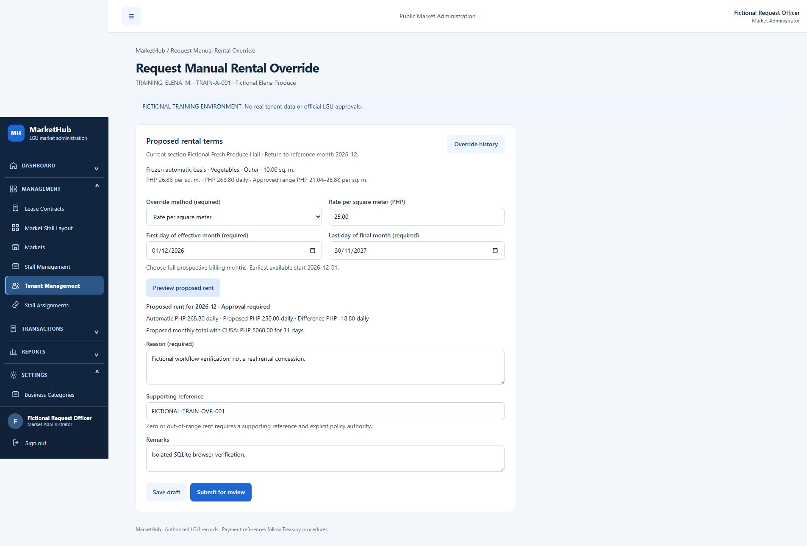

Figure 56. Per-square-meter override request in isolated fictional data.

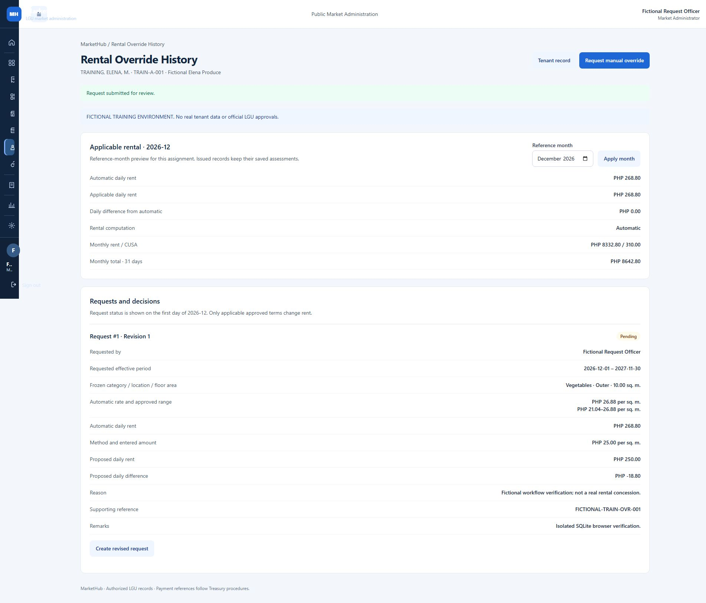

Figure 57. Pending request with automatic rent still applicable in isolated fictional data.

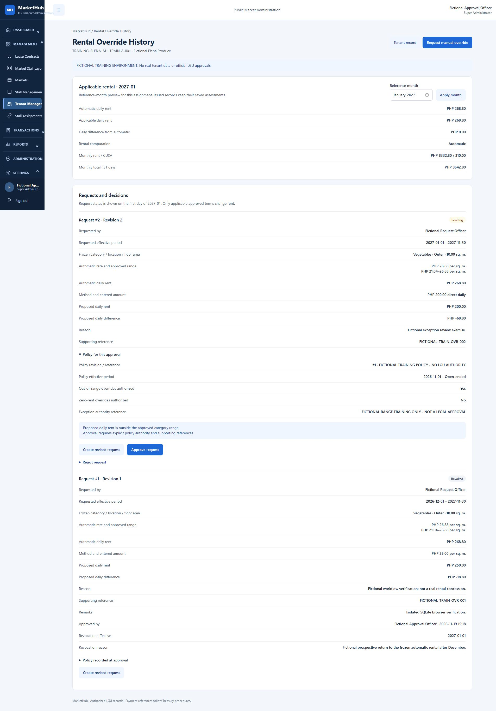

Figure 61. Approver warning for an out-of-range daily amount in isolated fictional data.

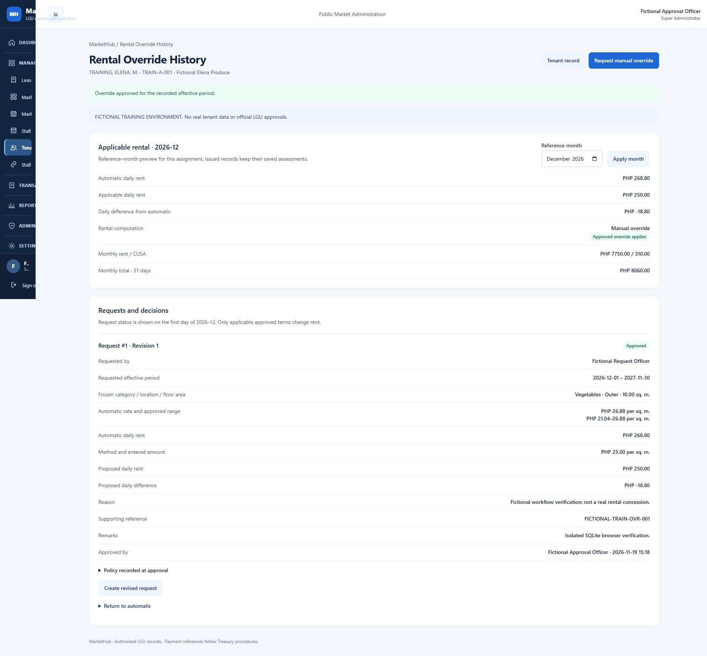

Figure 58. Approved December manual rental in isolated fictional data.

Figure 59. January automatic rental after prospective revocation in isolated fictional data.

## Chapter 8 — Rental and Payment Monitoring

### 8.1 Generate and post rental bills

1. Open **Transactions → Rental Billing** and choose the draft-generation action with `billing.generate`.
2. For monthly assignments choose **Monthly** and enter the billing month (`YYYY-MM`). For fixed-day assignments choose **Fixed-day** and enter **Fixed-day period start** (`YYYY-MM-DD`). Enter **Approved due date** and select eligible active assignments of that cycle, up to 500 per request.
3. Select **Generate drafts for review**.
4. Open each draft and check the tenant, stall, period and due date. On an assessed monthly bill, verify base rent and CUSA under its frozen rule. Legacy agreements use their saved monthly amount. A fixed-day bill displays the inclusive coverage range and base rent payable. The recorded CUSA amount appears for reference separately from the charges.
5. With `billing.post`, select the posting action only after review.

**Expected response:** generation states that draft bills are ready and **nothing was posted**. Posting displays **“Bill posted.”** Repeating generation returns the saved bill for the same assignment and period. Drafts affect the ledger only after posting. **Validation:** the due date must be on or after the period start. Future starts are unavailable. Earlier monthly periods and fixed-day starts before today require `financial.backdate`. Generation rejects mixed billing cycles, misaligned intervals and periods that extend beyond the assignment. **Common mistake:** interpreting generation as posting. The scheduler only creates eligible monthly drafts.

**Find an interval start.** Start at the assignment start date and advance by its saved day count. For a seven-day assignment starting 27 November, select 27 November for coverage through 3 December. Select 4 December for coverage through 10 December. Generate each interval separately when eligible. A shorter final fragment cannot be billed through this workflow.

Under the seeded roles, a Market Administrator can generate a fixed-day draft on the interval start. Generating a draft for an earlier fixed-day start requires both billing generation and backdate permissions. The Super Administrator has both under the seeded grants.

On the billing list, use the month filter to find periods beginning in that month. The **Fixed-day period start** filter selects one exact start date and takes precedence when both filters have values.

Figure 15. Billing list and review workflow in the monthly training example.

Figure 16. Assessed November bill with separate base rent and CUSA, posting state and balance.

Figure 69. Draft generation for the fictional fixed-day assignment beginning on 1 November.

Figure 70. Fictional posted bill for 1–7 November. The charge is PHP 1,400.00, and PHP 70.00 CUSA appears for records separately.

### 8.2 Record, review and post a payment

This is internal recording against approved Treasury procedures. The application does not issue an official LGU receipt, operate a cashier drawer, or replace accounting/collection authority. A typed receipt reference is a reference, not a generated official receipt.

1. With CO or SA, open **Transactions → Rental Payments**.
2. Select the tenant and **Load outstanding bills**.
3. Enter actual payment date, total amount, method (Cash, Bank transfer or Check) and actual Treasury receipt/reference number.
4. Allocate positive amounts to the tenant's posted outstanding bills. Leave unrelated bills blank.
5. Ensure allocations add exactly to the total received; select **Save draft and review**.
6. Review tenant, date, reference, allocations and amount on the draft.
7. With `payments.post`, post and confirm. Re-open the bill to verify its balance.

**Expected response:** first **“Payment recorded as draft. Review before posting.”**, then **“Payment posted; pending Treasury reconciliation.”** Only unreversed posted allocations reduce balances. **Validation:** date cannot be future; a date other than today needs `financial.backdate`; duplicate active receipt references are rejected. Allocation cannot exceed bill balance or belong to another tenant/draft bill. **“Allocate the entire payment exactly. Advance credit requires an approved policy.”** **Common mistake:** saving twice after an uncertain response, allocating a whole payment to several bills, or trying to record an advance when no posted obligation exists. Check Payment History before retrying.

Figure 17. Allocation form for Elena’s assessed November bill.

Figure 18. Saved payment draft awaiting review and posting.

Figure 19. Posted internal payment record; Treasury confirmation remains separate.

### 8.3 Balances, overdue accounts and history

1. Open **Outstanding Balances**; review bills with positive remaining balances, ordered by due date.
2. Use the overdue option where displayed to show due dates strictly before today.
3. Open a bill to inspect original amount, approved appended adjustments, applied payments and resulting balance.
4. Open **Payment History**, apply the displayed filters, and open a transaction for full allocations/reversal/confirmation details.
5. Use the Tenant Statement of Account report with a required tenant ID for a posted-bill statement.

**Expected response:** balance = posted original bill + appended adjustments − unreversed posted allocations. A fully paid bill is Paid; a positive past-due balance is Overdue; otherwise it is Partially paid when payment exists or Unpaid. Draft/posted is the document state; it is separate from these calculated payment labels. **Validation:** an empty receivables list may mean no posted positive balances, not no tenants. **Common mistake:** adding draft payments to collected totals or assuming “pending Treasury” means unposted. Posted pending-confirmation payments already affect balances and collection totals.

Figure 20. Posted outstanding balances and overdue monitoring.

Payment History supports tenant, stored status, officer, payment-date range and allocation-based market/section/stall filters in its controller; use controls actually displayed. A reversed payment remains a posted original plus a reversal record; the dedicated payment report handles a derived reversed status. Do not assume every filter in the master specification is exposed on every screen.

### 8.4 Correct errors without deleting history

1. For an incorrect draft, its recorder (or an appropriately permitted officer) uses **Void draft** with a meaningful reason, at least five characters. It remains in history.
2. For a posted error, TA or SA uses **Reverse** with a reason; the original payment remains and its allocations cease to affect balances.
3. Use the original transaction's linked correction action to create a replacement, then review and post it through normal permissions.
4. For a posted bill correction, TA or SA appends an adjustment with signed amount, reason and actual approval reference; never edit the original bill.
5. For reconciliation, TA or SA confirms an unreversed posted payment with a reason after checking the actual Treasury evidence.

**Expected response:** corrections and actors remain auditable; a replacement is linked to the voided/reversed source. **Validation:** posted payments require reversal, not draft voiding; only unreversed posted payments can be confirmed; adjustments must be nonzero and cannot create an advance credit. A reused receipt reference must follow its actual linked correction history. **Common mistake:** inventing a fresh receipt number to hide a correction or using a negative adjustment to erase more than the remaining balance.

Figure W06. Bill generation, authorized posting, payment allocation, reconciliation and appended correction paths.

## Chapter 9 — Dashboard and Monitoring

### 9.1 Update and interpret the overview

1. Open **Dashboard**.
2. Select a market or all markets, From and To dates, then **Update overview**. Default dates are the current year's first day through today.
3. Read the labels carefully: several indicators deliberately use all periods or today's date rather than the selected collection range.
4. Expand **Chart data in text** when a tabular/text view is easier to read.
5. Use the relevant operational report or source bill/payment for reconciliation; a chart is not an editable ledger.

**Expected response:** cards/charts use server-derived records. **Validation:** From/To use valid dates and To cannot precede From. **Common mistake:** comparing selected-month billing with lifetime outstanding as if both used the same time window.

| Dashboard item | Calculation and interpretation |
| --- | --- |
| Total stalls | All recorded stalls in selected market, including reserved, maintenance and inactive. |
| Occupied / vacant / reserved / maintenance / inactive | Counts by current stored operational status. |
| Occupancy | Occupied ÷ total recorded stalls × 100, rounded to one decimal; zero when no stalls. Inactive stalls remain in denominator. |
| Active tenants | Active tenant records; with a market selected, requires an active assignment in that market. All-market count can include unassigned active tenants. |
| Billed for selected months | Posted bill original amounts plus adjustments for bill-period months covered by selected From/To months. |
| Collected in date range | Allocations from unreversed posted payments whose payment dates fall in range; includes pending Treasury confirmation. |
| Outstanding · all periods | All posted bill totals minus effective allocations in selected market, irrespective of selected collection dates. |
| Overdue · as of today | Posted remaining balances with due date strictly before today, irrespective of selected range. |
| Monthly collections | Effective allocations grouped by payment year/month in the selected range. |
| Occupancy distribution | Current counts for each operational stall status. |
| Billing versus collections | Selected bill-month totals compared with date-range effective collections; they are not necessarily matched cohorts. |
| Receivables aging | Positive balances in 0–30, 31–60, 61–90, 91+ day brackets by due date relative to today. Due-today is in the first bracket; future due balances are excluded. |
| Collections by market | Effective date-range allocations grouped by market; not a separate section chart. |

### 9.2 Recent lists and limits

1. For payments, inspect **Recent posted payments** if permitted; at most five effective records are displayed in the chosen dates/market.
2. For tenants, inspect **Recently assigned stalls** and **Overdue accounts** if permitted, each limited to five. Recent assignments are latest records, not a filtered expiring-contract schedule.
3. For audit, inspect **Recent administrative activity** if `audit.view` is granted. This is a latest global activity list; market/date selection does not filter it.
4. Open full modules/reports to investigate records beyond these summaries.

**Expected response:** extra lists appear only for appropriate permissions. **Validation:** “No …” messages indicate no matching data in that limited list. **Common mistake:** assuming an absent widget means a feature was removed. There is no expiring-contract widget; use the Lease Contracts registry and coverage dates for manual review. No automatic expiration reminder is promised.

Figure 02 (repeated). Actual dashboard; range-based and all-period indicators are labeled separately.

## Chapter 10 — Reports and Printing

Wide print and PDF reports show each record in a readable field-and-value table, retaining all selected fields. CSV and Excel retain comparison rows. Apply filters before exporting.

### 10.1 Generate, preview and export

1. Open **Reports → All Reports** and select a report your role permits.
2. Set the applicable filters in the table below. Use numeric IDs in ID fields. The three assessment and category-related reports show only their applicable ID and assessed-location controls.
3. Select **Filter** and inspect the paginated on-screen preview (30 rows per page). Tab to the named results area and use the Left and Right arrow keys if columns extend past the available width.
4. Verify the report title, chosen criteria and source interpretation before distribution.
5. Select **CSV**, **Excel**, **PDF** or **Print view**. Export links preserve current criteria and omit the page number; exports cover the full filtered result up to the limit.
6. In Print view use the browser's print command and review paper/orientation/preview. The application PDF export uses A4 landscape.

**Expected response:** a permitted preview/download/print view reflects current query data. **Validation:** date range must be valid; IDs must exist; Tenant Statement requires tenant ID. Exports over 5,000 result rows return **“Export exceeds 5,000 rows. Narrow the date or market filters.”** **Common mistake:** entering a tenant name into a numeric ID field or expecting a visible filter to affect every report. Some shared controls on existing reports have no effect. Use the supported fields listed below.

Figure 21. Actual report catalog; report access depends on its permission.

Figure 22. Tenant Statement of Account for the assessed November bill and partial payment.

### 10.2 All twenty reports and supported filters

**Filter key:** M = Market ID; S = Section ID; St = Stall ID; T = Tenant ID; O = Officer ID; D = From/To date range; BC = Business category ID; L = Assessed location. Date basis is stated per report. All named permissions below are in addition to normal authentication/active-account requirements. Catalog access itself requires `reports.view`.

| Report | Purpose and actual data coverage | Permission | Supported filters / date basis |
| --- | --- | --- | --- |
| Stall Master List | Current stall code, market, section, classification, area and status. | reports.view | M, S, St; no date filter. |
| Occupied Stall Report | Same columns restricted to current occupied status. | reports.view | M, S, St; no date filter. |
| Vacant Stall Report | Same columns restricted to current vacant status; reserved/maintenance are excluded. | reports.view | M, S, St; no date filter. |
| Tenant Master List | Tenant reference, name, phone, email, address and status; not a government-ID export. | reports.personal | T; M matches any assignment history in market, not only active; no date filter. |
| Stall Assignment History | Stall, tenant/reference, agreement, assignment start/end/status, retaining prior occupancy. | reports.personal | M, S, St, T, D by assignment start. |
| Rental Billing | Posted bill reference, tenant, stall, period, due date, billed, paid and outstanding. Fixed-day rows include coverage and record-only CUSA. | reports.financial + reports.personal | M, S, St, T, D by bill due date. |
| Rental Collection Summary | Effective allocated collections grouped by payment month, plus Treasury-confirmed subset. | reports.view | M, S, St, T, O, D by payment date. |
| Daily Collections | Same effective allocation basis grouped by payment date. | reports.view | M, S, St, T, O, D by payment date. |
| Collections by Cashier | Effective allocations grouped by recording officer; “cashier” means recorded_by, not necessarily posting officer. | reports.financial | M, S, St, T, O, D by payment date. |
| Collections by Market / Section | Effective allocations grouped by market and section. | reports.view | M, S, St, T, O, D by payment date. |
| Outstanding Receivables | Posted bills with a positive current balance. Fixed-day rows include coverage and record-only CUSA. | reports.financial + reports.personal | M, S, St, T, D by due date. |
| Overdue Rental Accounts | Positive posted balances with due dates before today. Fixed-day rows include coverage and record-only CUSA. | reports.financial + reports.personal | M, S, St, T, D by due date. |
| Tenant Statement of Account | Current totals for the selected tenant's posted bills. Fixed-day rows include coverage and record-only CUSA. | reports.personal | T required; M, S, St, D by due date. |
| Payment Transaction History | Payment reference/date/tenant/amount/method/receipt/officer and derived reversal/reconciliation status; includes drafts/voids unless filtered. | reports.financial + reports.personal | T, O, D by payment date; M/S/St through allocated bills; status supported as request parameter. |
| Rental Rate History | Market, classification, amount, effective dates, approval reference/status. | rates.view | M, D by effective-from; no tenant/stall filter. |
| Audit Trail Report | Time, actor, action, entity type/ID and reason. | audit.view | D by created timestamp. |
| Business Category Report | Categories, associated businesses and active stall counts, Inner/Outer rates, revision status, dates and references. | rates.view | BC, D by rate effective-from date. |
| Rental Assessment Report | Frozen category, location, area, applied rate, period and calculated amounts. Fixed-day rows include coverage and CUSA treatment. | reports.financial | M, S, St, T, BC, L, D by creation time, recorded by date, and saved computation mode with override viewing permission. |
| Rental Override Report | Request terms, approval and exception authority, proposed and applicable daily rent, and status at the selected applicability date. | rentals.override.report | M, S, St, T, BC, applicability date, computation mode and request status. Section refers to the frozen assessment. |
| Lease Contract Registry | Control number, assessed category/location where present, lease dates/status, rental figures and document milestones. | contracts.view | M, S, St, T, BC, L, D by lease effectivity date. |

The payment report accepts `status=draft`, `posted`, `reversed` or `void` as an application request parameter, but the shared report form does not display a status selector. If needed, an authorized officer/MIS may supply a valid filtered link; do not document a nonexistent dropdown. `posted` excludes reversed records in that report, while `reversed` derives from the linked reversal. Audit and assessment date upper bounds include the full selected day. In the Lease Contract Registry, **Legacy / unclassified** matches records without an assessed location. Business Category Report and Lease Contract Registry display status. Use the listed date and scope filters for those reports.

The Rental Override Report uses recorded decisions and the assignment term to show what applies on the selected date. The proposed amount remains visible after rejection, expiry or revocation. The applicable amount is blank on a request row when another approved request applies on the selected date. Screen, CSV, Excel, PDF and print use the same filters. The Rental Assessment Report shows saved financial snapshots. Access to override fields and the assessment mode filter requires override viewing permission.

Figure 60. December Rental Override Report in isolated fictional data.

### 10.3 Interpret totals and handle files

1. Reconcile collections against effective payment allocations rather than all saved payment amounts.
2. Read `treasury_confirmed` as the confirmed subset of collected, not an additional amount to add.
3. Remember that historical bill reports show current applied payments/adjustments; they are not frozen “as of past date” financial statements.
4. Check CSV/XLSX column values before downstream calculations. Excel export writes explicit strings, and CSV protects values beginning with formula markers; automatic numeric/date conversion should be reviewed.
5. Store approved exports in the authorized location and restrict access to personal/financial data. Dispose of copies according to actual LGU procedures.

**Expected response:** totals remain traceable to source bills/payments. **Validation:** an empty result can export “No records”; it is not evidence of a missing database. **Common mistake:** interpreting an officer-grouped report as a report of official receipts issued by this application, or adding pending and confirmed values twice.

Figure W09. Permission check, applicable filters, preview, export limit and protected distribution.

## Chapter 11 — User Account and Administration

### 11.1 Create or update an account

1. With SA's `staff.manage`, open **Settings → Users and Roles**.
2. For a new account, enter the officer's name, unique email, private password and matching confirmation.
3. Select one of the six predefined roles and Active/Disabled state. Use the least access required by actual duties.
4. Save and verify **“Account and role saved.”** Have the intended officer test access privately.
5. To update, expand the existing account, correct name/email/role/state and save. Leave password blank to keep it; enter and confirm a new password only for an authorized reset.

If a save returns an error, follow its link from **Please check the following**. The submitted account form keeps its name, email, role and status. Its existing-account panel reopens if it was an update. Enter the password and confirmation again if the requested change requires them.

**Expected response:** the named account and selected role are saved, and any new password is hashed. **Validation:** password is at least 12 and at most 128 characters with confirmation; email must be valid and unique; role must be predefined. The last active SA cannot be disabled or demoted; the current user cannot disable their own account. **Common mistake:** saving an account without checking that role selection replaces existing roles, or emailing/sharing a password in screenshots. No arbitrary permission editor, first-login-change enforcement or self-service recovery is implemented.

Figure 23. Staff account creation and expandable update forms; no secrets are displayed.

### 11.2 System settings and audit

1. Open **Settings → System Settings** with `settings.manage`.
2. Enter organization name (required, at most 120 characters) and optional notice (up to 500), then save.
3. With `audit.view`, open **Administration → Audit Logs**.
4. Search an action fragment, such as `payment`, `contract`, `account` or `assignment`, then inspect actor, time, entity and available reason/values.
5. Use the Audit Trail Report for a date-filtered export if authorized.

**Expected response:** **“Settings saved.”** Audit lists retain chronological activity and responsible accounts. The audit screen shows thirty records per page. **Validation:** missing organization name or excessive lengths are rejected. **Common mistake:** assuming this screen sets rental-policy/numbering approval, changes roles, or provides audit deletion. It edits only the displayed organization name and notice. Lease policy configuration is a controlled MIS task outside these two settings.

Figure 24. Actual display settings; financial-policy approval is not established here.

Figure 25. Actual audit list with action search; record details depend on the event.

### 11.3 Administrative security routine

1. Confirm access requests against actual appointment and duties before creating or changing roles.
2. Record the authorization through the LGU's approved administrative process; an application role name is not a legal appointment.
3. Disable accounts for personnel who no longer require access, using another authorized administrator where needed.
4. Investigate unusual login failures, role changes, repeated corrections or document-integrity errors with MIS.
5. Have MIS protect backups, private files and `APP_KEY`; the key is needed to read encrypted ID data and contract snapshots.

**Expected response:** administration is attributable to named accounts. **Validation:** safeguards prevent self-disable/last-administrator removal but do not replace an access review. **Common mistake:** retaining a shared SA account for convenience. Full security certification, regulatory compliance and deployment approval are not claimed.

Figure W08. Authorized account provisioning, role selection, safeguards and audit.

## Chapter 12 — Complete 360° Operational Workflow

### 12.1 Training case and evidence boundaries

Use the fictional stallholder **TRAINING, ELENA, M.**, who trades in **Vegetables**. Use **TRAIN-A-001** in **Training Public Market**, an **Outer** stall of **10.00 sq. m.** The exercise term is **2026-11-01 to 2027-01-31**. Before reusing it on another training date, check the current date restrictions and available synthetic approvals.

In the example the approved category revision specifies **PHP 21.04 minimum** and **PHP 26.88 maximum** per sq. m. per day. Outer applies **PHP 26.88**, so daily base rent is **PHP 268.80**. November has **30 calendar days**. With daily CUSA of **PHP 10.00**, November base rent is **PHP 8,064.00**, monthly CUSA is **PHP 300.00** and total monthly rent plus CUSA equals **PHP 8,364.00**. The two-month advance is **PHP 16,128.00** and the deposit is **PHP 8,064.00**, for a combined **PHP 24,192.00**. With one posted **PHP 2,000.00** allocation and no other activity, the expected November balance is **PHP 6,364.00**.

The isolated browser run confirmed registration, posted the assessed November bill and recorded and posted the PHP 2,000.00 allocation. The captions identify actual training screens and older legacy examples where applicable. The Coverage Matrix describes observed actions and acceptance limits. Training references are fictional and may be used only in an isolated exercise.

### Step 1 — Administrator logs in

**Responsible:** SA. **Prerequisites:** an authorized active training account and isolated database. **Menu/path:** application login.

1. Open the isolated training URL and enter the administrator's email/private password.
2. Select **Sign in** and verify account identity on the dashboard.

**Input:** account credentials, never printed in this manual. **Expected:** authenticated dashboard and login audit. **Validation:** incorrect/disabled credentials and lockout messages from Chapter 2. **Common mistake:** using a production account in a public training session. **Next:** confirm market configuration.

Figure L01. Actual login screen for lifecycle step 1; credentials omitted.

### Step 2 — Administrator configures the market

**Responsible:** SA or MA with `markets.manage`. **Prerequisites:** approved training identifiers. **Menu:** Management → Markets; Settings → Market Sections.

1. Create or locate **Training Public Market** with a synthetic unique code.
2. Create or verify its active training section. Reuse the same market in all later steps.

**Input:** market code/name/address/status and section code/name/market/status. **Expected:** saved market/section available in stall selectors. **Validation:** duplicate codes and occupied-location deactivation restrictions. **Common mistake:** recreating a fixture record already present. **Next:** register TRAIN-A-001.

Figure L02. Actual configured market directory; fixture initialization and browser display are distinct from a browser-submitted market creation.

### Step 3 — Administrator registers the stall

**Responsible:** SA, MA or permitted MS. **Prerequisites:** configured market, section and category. **Menu:** Management → Stall Management.

1. Create or verify **TRAIN-A-001** in **Training Public Market**.
2. Set area **10.00 sq. m.**, location **Outer**, required physical classification and **Vacant** status. Save and verify the stall record and map.

**Input:** code, location, category/classification, area and operational fields. **Expected:** retained synthetic stall. **Validation:** duplicate market/code and invalid area/section rejected. **Common mistake:** guessing the stall location. **Next:** configure the applicable category and market policy.

Figure L03. Actual stall form used to identify required inventory inputs.

### Step 4 — Administrator configures rental rates and policy

**Responsible:** MA or SA prepares drafts. An authorized SA approves. **Prerequisites:** clearly fictional authority references for this isolated exercise. **Menu:** Settings → Business Categories and Rental Policies.

1. Locate **Vegetables** and review the rate history. For the exercise, the approved revision covers **2026-11-01** with **21.04 minimum** and **26.88 maximum**.
2. Verify the approved policy covers Training Public Market on the same date. It specifies daily CUSA of **10.00** and **Calendar days**.
3. If preparing the fictional approvals, verify effective ranges and review the latest draft before approving it.

**Input:** exact rate range, policy basis, effective dates and synthetic references. **Expected:** an eligible revision and market policy for preview and confirmation. **Validation:** a draft, stale review screen or overlapping approved revision cannot supply new assessment authority. **Common mistake:** assuming the undated seed provides authority. **Next:** assign named staff roles.

Figure L04. Actual category history for reviewing the training rate basis.

### Step 5 — Administrator creates staff accounts

**Responsible:** SA. **Prerequisites:** approved role allocation and private strong passwords. **Menu:** Settings → Users and Roles.

1. Create named training staff accounts using synthetic emails in the isolated database.
2. Select MS for tenant/stall preparation, MA for assignment/billing, CO for payment entry/posting, and TA for reconciliation/corrections as duties require.

**Input:** name, unique email, confirmed password, role and active status. **Expected:** account/role saved. **Validation:** minimum password, unique email and last-SA safeguards. **Common mistake:** assigning MS then expecting assignment/billing/payment creation. **Next:** staff signs in separately.

Figure L05. Actual staff-management form; training credentials are not exposed.

### Step 6 — Authorized staff logs in

**Responsible:** named MS/MA/CO as appropriate. **Prerequisites:** active account. **Menu:** sidebar Log out → login.

1. Administrator logs out; the responsible officer signs in with their own credentials.
2. Confirm role identity and visible menus. Use separate authorized sessions when demonstrating separation of duties.

**Input:** own email/private password. **Expected:** role-filtered menu. **Validation:** 403 means permission denied, not a prompt to share SA credentials. **Common mistake:** assuming the administrator's open session proves a staff role works. **Next:** MS registers the tenant.

Figure L06. Actual responsive navigation; available links vary by role, and this image does not certify all role sessions.

### Step 7 — Staff registers the tenant and business

**Responsible:** MS, MA or SA. **Prerequisites:** fictional identity and business details. **Menu:** Management → Tenant Management → Register tenant.

1. Enter last name **Training**, first name **Elena**, middle initial **M.**, fictional address/contact and identification for this isolated exercise.
2. Add the associated **Vegetables** business. This exercise includes verified permitted goods because a later step prepares a lease.
3. Save the registration draft while the stall selection and approval checks are pending. If the tenant already exists, open that profile and use its **Businesses** tab.

**Input:** verified training details from Chapter 6. **Expected:** a generated tenant reference and reviewable draft/profile. **Validation:** missing structured names and invalid email are rejected. **Common mistake:** creating a second tenant to register another business. **Next:** inspect stall availability.

Figure L07. Fictional tenant registration through Tenant Management.

### Step 8 — Staff checks stall availability

**Responsible:** role with `map.view`; tenant/financial details need their own permissions. **Prerequisites:** TRAIN-A-001 inventory exists. **Menu:** Management → Market Stall Layout.

1. Select **Training Public Market**, filter vacancy if desired, and select **TRAIN-A-001**.
2. Verify the code, market, **Outer** location, 10 sq. m. area and **Vacant** label. Inspect history where permitted.

**Input:** market/section/status filters. **Expected:** selected-stall detail panel. **Validation:** no matching tiles means check filters/location. **Common mistake:** equating a gray tile with approval to assign without occupancy/rate checks. **Next:** MA/SA assigns the tenant.

Figure L08. Actual map/detail screen; occupancy colors are separate from payment status.

### Step 9 — Staff assigns the available stall

**Responsible:** MA or SA. **Prerequisites:** eligible stall and effective authority for the business category and market policy. **Menu:** Tenant Management → Resume registration; alternatively Stall Assignments → Assign a tenant for a confirmed tenant.

1. Select **TRAIN-A-001** for Elena’s Vegetables business. Enter **2026-11-01** start and **2027-01-31** end. The earlier exercise uses a unique training agreement reference. The current form generates an internal reference if the field is blank.
2. Review the preview showing the Outer rate and November rent plus CUSA of **8,364.00**. Record up to two assignment helpers where applicable.
3. Select **Confirm registration** and review the resulting profile, assessment and occupied status.

**Input:** linked stall/business, dates and reference. **Expected:** active assignment, frozen rental assessment and occupied stall. **Validation:** confirmation rechecks location, approved dates, ownership, occupancy and any additional-assignment authority. **Common mistake:** treating a draft or preview as a reserved stall. **Next:** prepare the legal document record.

Figure L09. Actual Outer Vegetables assessment preview for the fictional exercise.

### Step 10 — Staff creates the lease record

**Responsible:** MS, MA or SA with `contracts.create`. **Prerequisites:** active assessed assignment and approved template. **Menu:** Tenant Management → Lease Contracts tab → Prepare lease contract, or Management → Lease Contracts → create draft.

1. Select Elena’s TRAIN-A-001 assessed assignment and the eligible template.
2. Enter synthetic **2026-11-01 to 2027-01-31** lease dates and the applicable execution date.
3. Review the frozen goods and November total **8,364.00**, along with the advance/deposit breakdown. Use the authorized assignment renewal workflow if the underlying business or rental terms need a new basis.

**Input:** assessed assignment, lease dates and approved template. **Expected:** saved contract draft and breakdown. **Validation:** missing template, overlapping contract period or invalid dates block saving. **Common mistake:** expecting a draft to post rent or collect an advance. **Next:** permitted generation and genuine review.

Figure L10. Lease draft form for reviewing an assessed assignment and entering the contract dates.

### Step 11 — Staff generates and prints the contract

**Responsible:** MA/SA generates/downloads/prints; SA separately reviews/approves/issues under actual authority. **Prerequisites:** complete verified profile, approved effective template and applicable real review environment.

1. Open the draft, verify current tenant identity, verified ID and authorized assignment helpers, confirm signatory information and select **Generate DOCX**.
2. Download the preserved original; inspect all pages in a compatible renderer before any approval or printing for execution.
3. Stop at the review gate unless an authorized officer actually performs the comparison and policy references exist. Printing a training sample does not issue a contract.

**Input:** verified signatory data and actual review reference only when justified. **Expected:** `ready` and original file; optional PDF only if conversion works. **Validation:** incomplete ID, unsupported civil status or checksum/policy failure blocks progress. **Common mistake:** checking nine-page review without opening the file. **Next:** verify independent occupancy.

Figure L11. Actual generated-ready screen; final Word fidelity, legal review and authorized issuance are not inferred from it.

### Step 12 — Staff verifies occupancy

**Responsible:** map viewer; MA/SA investigates assignment errors. **Prerequisites:** saved assignment from step 9. **Menu:** Market Stall Layout and Tenant profile.

1. Refresh TRAIN-A-001 and confirm **Occupied**.
2. Confirm the current tenant, dates and calculated November total of **8,364.00**.

**Input:** same stall/market selection. **Expected:** occupied status from the saved assignment. **Validation:** if vacancy persists, verify assignment save and correct market before retrying. **Common mistake:** editing status to mask a failed assignment. **Next:** monthly bill and recorded payment.

Figure L12. Saved training tenant profile. Check Stall Assignments and the map for occupancy.

### Step 13 — Staff records rental payment information

**Responsible:** MA/SA generates/posts bill; CO/SA records/posts payment. **Prerequisites:** full November coverage, reviewed due date and actual authorized training references. **Menu:** Transactions → Rental Billing / Rental Payments.

1. Generate the November **2026-11** bill draft. Review **8,064.00** base rent and **300.00** CUSA, then post **8,364.00** under proper permissions.
2. Load Elena's outstanding bills. Enter **2,000.00**, today's permitted payment date, method and unique synthetic receipt reference; allocate **2,000.00** to that bill.
3. Save draft, review, post and confirm that it remains pending Treasury confirmation.

**Input:** period/due date, amount/method/reference, exact allocation. **Expected:** outstanding **6,364.00** after posting. **Validation:** full-month rule, date/backdate permission and exact allocations. **Common mistake:** trying to record **24,192.00** initial advance/deposit as an unsupported advance payment. **Next:** verify history/balance.

Figure L13. Actual payment allocation form for the assessed November training bill.

### Step 14 — Staff reviews balances and history

**Responsible:** billing/payment viewer; TA/SA for reconciliation. **Prerequisites:** posted bill/payment. **Menu:** Outstanding Balances; Payment History.

1. Open the November bill and verify **8,364.00 − 2,000.00 = 6,364.00**, absent other adjustments/payments.
2. Check Elena's posted payment reference/date and pending/confirmed state; use TA/SA confirmation only against actual evidence.

**Input:** tenant and date filters where displayed. **Expected:** traceable effective allocation and balance; overdue depends on the chosen due date and today. **Validation:** a draft payment leaves the full **8,364.00** outstanding. **Common mistake:** including a draft allocation in the posted balance. **Next:** management overview.

Figure L14. Assessed training bill with PHP 6,364.00 remaining after the posted partial payment.

### Step 15 — Management monitors the dashboard

**Responsible:** MV or another permitted viewer. **Prerequisites:** posted activity and known filters. **Menu:** Dashboard.

1. Select Training Public Market and date range containing the payment.
2. Read occupancy and compare billed/collected with all-period outstanding; use Chapter 9 definitions.

**Input:** market, From/To. **Expected:** server-derived cards/charts; permission-limited recent lists. **Validation:** invalid reversed date range rejected. **Common mistake:** expecting a management viewer to see personal payment rows or an expiring-contract widget. **Next:** export permitted reports.

Figure L15. Actual dashboard context; viewer permissions still apply independently.

### Step 16 — Authorized personnel generate reports

**Responsible:** role with the specific report permission. **Prerequisites:** Elena's actual numeric tenant ID and supported filter basis. **Menu:** Reports → All Reports.

1. Generate the relevant Occupancy, Rental Billing, Payment History or Tenant Statement report under suitable roles.
2. Use the required tenant ID for the statement. For the assessed November example, check **8,364.00 billed**, **2,000.00 paid** and **6,364.00 outstanding** if these are the only effective transactions.
3. Preview and export/print only permitted data.

**Input:** supported IDs/dates. **Expected:** posted or effective values according to report type. **Validation:** tenant required, 403 access restriction or 5,000-row limit. **Common mistake:** entering a payment date for Rental Billing, which filters by bill due date. **Next:** future authorized closure or renewal.

Figure L16. The assessed November statement shows PHP 8,364.00 billed, PHP 2,000.00 paid and PHP 6,364.00 outstanding.

### Step 17 — Staff processes renewal or termination

**Responsible:** MA/SA for occupancy; SA for contract void/termination/issuance actions. **Prerequisites:** real authorization, eligible dates and resolved bill constraints. **Menu:** Stall Assignments → Transfer / renew or End; Lease Contracts → closure.

1. At the appropriate authorized date, review the existing contract, assignment and bills.
2. Renew through a separate same-stall assignment/agreement, or terminate/void the document with a specific reason and separately end occupancy.
3. A future renewal must wait until its eligible start date. Figure 40 shows a reasoned void and retained original in a prior isolated training case.

**Input:** eligible business and stall, dates, any new agreement reference provided, or the closure reason. **Expected:** retained old history and separate new history, or controlled closure. **Validation:** this monthly example checks first-of-month transfers, future starts, saved bill coverage and the contract reason minimum. **Next:** inspect availability after actual ending.

Figure L17. Actual renewal/transfer form; future renewal remains unavailable at the exercise date. Figure 40 separately shows the demonstrated synthetic contract void.

### Step 18 — Staff updates stall availability

**Responsible:** MA/SA ends occupancy; permitted stall maintainer sets eligible operational status. **Prerequisites:** completed eligible end/transfer, never just document closure. **Menu:** Stall Assignments; Stall Management; Market Stall Layout.

1. After actually ending the assignment, refresh TRAIN-A-001 and confirm **Vacant**.
2. If authorized maintenance/reservation is needed, edit the released stall's operational status and verify again.

**Input:** actual end date/reason and authorized status where needed. **Expected:** ending releases active occupancy and retains history. **Validation:** cannot force an occupied stall vacant through edit. **Common mistake:** interpreting the training occupied-map screenshot as proof that a later release occurred. **Next:** review retained history.

An earlier isolated case demonstrated the same full-month rule. The posted November bill blocked a midmonth ending, so the stall stayed occupied. A later eligible closure needs authorized handling at the proper date.

Figure L18. Blocked midmonth ending and retained occupancy in an isolated training case.

### Step 19 — Authorized personnel review history and audit

**Responsible:** appropriate tenant/payment viewer; TA/SA for audit. **Prerequisites:** legitimate purpose and permission. **Menu:** Tenant profile; Stall Assignments; Payment History; Audit Logs.

1. Open Elena's profile and retained assignments/contracts/payment references.
2. Search audit actions and correlate responsible accounts, times and reasons with the source records.
3. Preserve original bills/payments, reversals and signed documents. Log out and secure training exports.

**Input:** record IDs/action search/date-filtered audit report. **Expected:** an attributable chain of activity without deletion of posted originals. **Validation:** unauthorized history/audit access is denied; a closed contract remains visible to permitted users. **Common mistake:** deleting training files from an operational private-document store or assuming an audit export proves every action has been independently accepted. **Next:** close the exercise and record actual verification gaps for MIS/LGU review.

Figure L19. Actual audit list; actor/action history is inspected through authorized access.

Figure W10. Complete lifecycle with responsible roles, separate gates and retained historical records.

### 12.2 Separate December and January override exercise

The fictional assignment for TRAIN-A-001 uses 10.00 sq. m. and an automatic daily rent of PHP 268.80. A requester submitted PHP 25.00 per sq. m. A separate officer approved the December 2026 to November 2027 request using a fictional training policy. December applied PHP 250.00 daily, a PHP 18.80 decrease. For 31 billing days the base is PHP 7,750.00, CUSA is PHP 310.00 and the monthly total is PHP 8,060.00. The generated training contract calculated PHP 15,500.00 advance, PHP 7,750.00 deposit and PHP 23,250.00 total initial payment.

The officer voided the generated contract before issuance and the original Word file was retained. A prospective return to automatic effective 1 January 2027 kept December’s manual terms and restored January’s frozen PHP 268.80 daily and PHP 8,642.80 monthly total. A separate direct PHP 200.00 daily request showed the out-of-range warning and was rejected. This exercise verified previews and unissued contract generation. No future bill was posted in the browser.

Figure 62. Unissued training contract generated from manual rent in isolated fictional data.

### 12.3 Separate fixed-day billing exercise

For this exercise, use an authorized fixed-day training installation and a fictional stall with base rent of PHP 200.00 daily. Save an eligible assignment beginning 1 November with the seven-day interval and PHP 10.00 daily CUSA for reference. Each full interval has PHP 1,400.00 base rent payable and PHP 70.00 record-only CUSA.

When the dates are eligible, generate a draft for 1 through 7 November and a separate draft for 8 through 14 November. Check that the bill references and coverage differ and that each bill charges PHP 1,400.00. Open a reviewed draft and post it with the usual permission. A duplicate request for the same assignment and start keeps the original amount and due date. Generate only complete intervals within the term.

## Chapter 13 — Troubleshooting and Frequently Asked Questions

### 13.1 Resolve a problem safely

1. Read the exact message and note the page, action and time.
2. Before resubmitting a financial/assignment form, inspect the relevant list to determine whether the first save succeeded.
3. Correct only verified inputs within your authority. Do not bypass validation, change server time or alter posted records directly.
4. Escalate with record references and sanitized evidence. Never send passwords, session cookies, tokens, private ID numbers or full private contracts through an unapproved channel.

**Expected response:** the issue is resolved or reproducible evidence reaches the responsible officer. **Validation:** some policy/state errors require authorization rather than another technical retry. **Common mistake:** repeatedly posting because a browser took too long, thereby obscuring the original problem.

| Scenario | Operator action and escalation |
| --- | --- |
| Cannot open local URL / 403 / loading issue | Confirm authorized address, workstation and network. Ask MIS to check Apache/public-only routing and logs; do not publish project root or change unrelated XAMPP apps. |
| Incorrect email/password or disabled account | Re-enter own email once carefully; administrator verifies active state/reset privately. There is no self-service recovery page. |
| Too many login attempts | Wait the stated interval. Repeated unexpected failures should be reported to administrator/MIS. |
| Missing menu | Expand the group, confirm role/account, then request an authorized access review. Empty groups are intentionally hidden. |
| Access denied / 403 on action | Check permission matrix and record state; ask the appropriate officer. Typing a route manually does not grant access. |
| Session expired / 419 | Sign in again, reopen a fresh form and check whether the prior save exists before resubmitting. Avoid old tabs with stale tokens. |
| Required-field validation | Review the error summary, follow a link to the affected input when shown, and correct the values. A browser required-field prompt may appear before server submission. |
| Duplicate stall | Search the correct market/code. Edit the existing stall if appropriate; do not add punctuation to evade uniqueness. |
| Suspected duplicate tenant | Search name/reference/account/phone and verify identity. Duplicate account numbers or names alone are not proof; no automated merge is provided. |
| Rate or policy cannot be approved | Verify current draft terms, official reference, effective dates and overlapping approved revisions. If the draft changed, reopen and review it before approval. |
| Cannot assign stall | Check the active tenant and linked active business/category, stall status, verified Inner/Outer and area, approved category rate and dates. Check effective market policy where required. For concurrent occupancy, enter the reason and verify approved capacity in every involved market. |
| Tenant cannot be archived | End active assignments through the authorized workflow first. Do not erase the tenant or relabel occupancy. |
| No approved template | Authorized template manager registers the preserved source, obtains real visual review and records approval. Do not invent approval references. |
| Lease draft or generation fails | For a draft, check that the assessment contains verified permitted goods or services and matches the current business details. For generation, check structured names, address/phone, ID, civil status, template date and checksum. |
| Contract PDF unavailable | Use original DOCX for authorized inspection/printing; MIS must configure/test a compatible local converter. This does not affect report PDF export. |
| Contract issue fails | Confirm ready document, actual review approval, configured numbering/rental-policy references and current eligible term. Do not bypass gates. |
| Unexpected contract amount | Compare the assessed area, location, category rate, frozen policy, reference-month days and CUSA. Under calendar billing, different months can have different totals. Refer a stale business or rental basis for authorized renewal. |
| Incorrect posted bill/payment | Use adjustment, reversal and linked correction with reasons and proper roles. No ordinary direct edit/delete of posted originals. |
| Payment allocation fails | Use the selected tenant's posted positive balances; allocation sum must exactly equal total and each amount cannot exceed bill balance. |
| Duplicate receipt reference | Check pending drafts and posted history. Use the actual void/reversal correction link rather than unrelated receipt reuse. |
| Payment does not reduce balance | Check it is posted and unreversed, with allocation to the intended bill. Drafts do not count. |
| Report is empty / filters seem ignored | Confirm supported filters and date basis in Chapter 10. Shared controls may be irrelevant to that report branch. |
| Cannot export / print | Check permission, browser download/print settings and 5,000-row limit. Narrow supported filters; report file/integrity failures to MIS. |
| Fixed-day bill generation fails | Check the assignment's saved interval, the alignment of the start date, full term coverage, due date and backdate permission. Use one billing cycle per request. |
| Future renewal or a partial period is rejected | Check the term's saved billing cycle, date rules and existing coverage. Ask the authorized officer about the supported correction workflow. |

### 13.2 Frequently asked operational questions

**Does green mean paid?** No. It means occupied. Read bill balances and payment labels separately.

**Does saving a payment collect money or issue an official receipt?** It records internal information referencing approved Treasury procedures. It issues no official LGU receipt. Draft save, posting and Treasury confirmation are distinct.

**Can Market Staff assign a tenant or post payments?** No under seeded defaults. MA/SA handles assignments; CO/SA handles payment record/post actions.

**Does contract termination free the stall?** No. End/transfer the occupancy assignment separately, respecting bills and date rules.

**Which rate applies after a schedule change?** Current assessed agreements continue with their frozen terms. Legacy agreements use their stored monthly rent. A new approved assessment applies to a properly authorized new term. Use appended corrections for errors in posted history.

**Can the workbook be imported now?** No import interface is implemented. Keep the original private and follow a separately approved preview/matching process for future work.

**Can I change my own password here?** There is no self-service screen. An authorized account administrator can reset it through Settings → Users and Roles.

**Why can two assessed monthly totals differ?** Both use the frozen terms. Under a calendar policy the contract’s reference month and the bill’s month may have different day counts. Check the period on each record.

**Where do I change the fixed-day interval?** Choose the interval on a new assignment or eligible renewal when fixed-day entry is enabled. The original assignment keeps its saved interval, amount basis and bills.

**Can I assign a stall without an agreement reference or a goods description?** Yes. Supply a unique agreement reference if available or leave it blank for the application to generate. Goods or services can be blank for assignment. A later monthly lease draft still needs verified goods or services in its assessment.

**Does this manual establish production readiness?** No. Actual deployment, unsupported-stack risks, MySQL locking/UAT and authorized legal/document visual review remain separate acceptance responsibilities.

## Chapter 14 — Data Privacy and Security

### 14.1 Handle records according to purpose and permission

1. Access only the tenant/financial records required for your authorized duty.
2. Verify identity and purpose before disclosing tenant contact, account or government-ID information.
3. Use masked views where possible. Full ID access is separately restricted; the ordinary tenant list omits full ID numbers.
4. Do not copy unnecessary ID numbers into remarks, report titles, tickets, audit search fields or training screenshots.
5. Share exported reports and contracts only through approved channels and with authorized recipients.

**Expected response:** access remains attributable and sensitive fields are handled deliberately. **Validation:** a denied sensitive view is an access boundary; it is not a reason to obtain another officer's credentials. **Common mistake:** assuming that permission to view a whole screen grants permission to distribute it externally. This manual makes no claim of regulatory compliance, certification or independent privacy assessment.

### 14.2 Protect accounts and shared workstations

1. Use a named account and a strong private password; do not reuse a shared administrator login.
2. Keep passwords out of emails, printed instructions, source files and screenshots.
3. Ask the authorized administrator for a reset when compromised; there is no self-service password-change page.
4. Review downloads/print queues and log out after work, especially on a shared device.
5. Confirm the login page is displayed before leaving; lock the workstation using the organization's normal procedure.

**Expected response:** another user cannot continue your authenticated work. **Validation:** session timeout may interrupt a form; check saved records after signing in. **Common mistake:** leaving a contract or sensitive report open after application logout. The browser/document viewer may retain downloaded copies independently.

### 14.3 Protect printed and downloaded documents

1. Check preview, recipient and printer before printing a contract or report.
2. Retrieve pages promptly. Keep originals and signed copies under actual records procedures.
3. Store downloads in approved locations; avoid uncontrolled personal devices/cloud folders.
4. Verify filenames and checksums/integrity errors through the application/MIS; do not repair a private generated file in place.
5. Follow authorized retention/disposal rules. This manual does not invent a retention period.

**Expected response:** printed/downloaded material retains its approved purpose and confidentiality. **Validation:** private document downloads can fail on missing paths or checksum mismatch; notify MIS rather than replacing the file. **Common mistake:** editing an issued original DOCX and calling it a reprint. Reprints must retrieve the preserved original; corrections follow authorized history.

### 14.4 Report incidents and maintain the reference

1. Report suspicious login attempts, unexpected role changes, missing private documents or unauthorized disclosure to the administrator/MIS using the organization's incident channel.
2. Record time, page/action and safe record reference; omit passwords/tokens and unnecessary personal data.
3. Avoid further changes to affected records until the authorized incident response directs them.
4. For a legitimate feature/menu/permission change, have maintainers update affected manual sections, screenshots, workflow diagrams and coverage evidence together.
5. Check **Help & Support** for document version/last updated date before using a printed copy as current guidance.

**Expected response:** incidents and changes reach authorized personnel with useful evidence. **Validation:** application tests and this manual do not establish a complete incident-response program. **Common mistake:** distributing a stale printed procedure after workflow changes. Consult the current operational reference and actual approved LGU policy when they differ.

### Reference documents and verification record

Maintainers should consult `docs/MASTER_SPEC.md`, `docs/CONTRACT_IMPLEMENTATION_REPORT.md`, `docs/TENANT_FIELD_MAPPING.md`, `docs/CONTRACT_TEMPLATE_MAPPING.md`, `docs/CONTRACT_GENERATION_SETUP.md`, `docs/architecture/NAVIGATION.md`, operational installation/security guidance and the current source. The accompanying `COVERAGE_MATRIX.md`, screenshot index and regeneration README distinguish source review, disposable automated tests, isolated browser evidence and pending acceptance work. Documentation generation does not migrate or approve the operational system.
